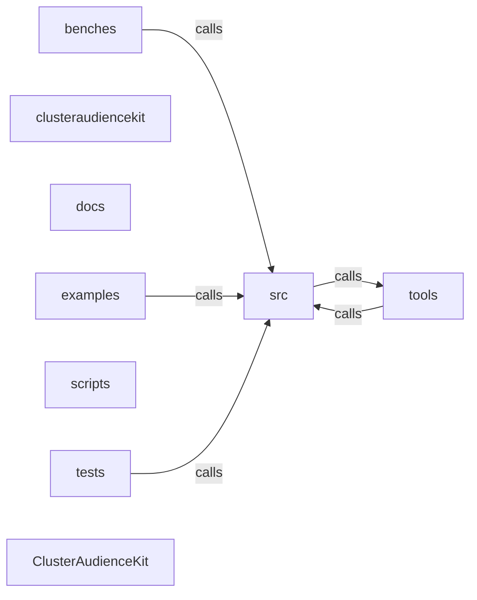

_Generated by CodeAtlas._

## Details

Architecture map of ClusterAudienceKit.

### benches

Owns 4 symbols across 1 file(s).

**Related Classes/Methods:** _None_

**Source Files:**

- `benches/benchmarks.rs`
  - `benches.benchmarks.bench_kmeans`
  - `benches.benchmarks.bench_rfm`
  - `benches.benchmarks.synthetic_blobs`
  - `benches.benchmarks.synthetic_transactions`

### clusteraudiencekit

Owns 0 symbols across 1 file(s).

**Related Classes/Methods:** _None_

### docs

Owns 0 symbols across 5 file(s).

**Related Classes/Methods:** _None_

### examples

Owns 14 symbols across 3 file(s).

**Related Classes/Methods:** _None_

**Source Files:**

- `examples/basic_segmentation.py`
  - `examples.basic_segmentation.generate_sample_data`
  - `examples.basic_segmentation.main`
- `examples/sql_export_example.py`
  - `examples.sql_export_example.example_10_error_handling`
  - `examples.sql_export_example.example_1_basic_export`
  - `examples.sql_export_example.example_2_all_dialects`
  - `examples.sql_export_example.example_3_custom_columns`
  - `examples.sql_export_example.example_4_batch_export`
  - `examples.sql_export_example.example_5_rfm_patterns`
  - `examples.sql_export_example.example_6_production_workflow`
  - `examples.sql_export_example.example_7_dialect_specific`
  - `examples.sql_export_example.example_8_large_scale_export`
  - `examples.sql_export_example.example_9_integration_patterns`
  - `examples.sql_export_example.main`
- `examples/streaming_updates.py`
  - `examples.streaming_updates.main`

### scripts

Owns 0 symbols across 5 file(s).

**Related Classes/Methods:** _None_

### src

Owns 231 symbols across 2 file(s).

**Related Classes/Methods:** _None_

**Source Files:**

- `src/lib.rs`
  - `src.lib.ClusterAudienceKitError`
  - `src.lib.tests.test_version`
- `src/python.rs`
  - `src.python.PyAudienceSegmenter`
  - `src.python.PyAudienceSegmenter.__repr__`
  - `src.python.PyAudienceSegmenter.fit`
  - `src.python.PyAudienceSegmenter.get_n_clusters`
  - `src.python.PyAudienceSegmenter.get_n_jobs`
  - `src.python.PyAudienceSegmenter.new`
  - `src.python.PyAudienceSegmenter.predict`
  - `src.python.PyBehavioralRule`
  - `src.python.PyBehavioralRule.new`
  - `src.python.PyBehavioralRule.to_sql`
  - `src.python.PyBehavioralSegment`
  - `src.python.PyBehavioralSegment.matches`
  - `src.python.PyBehavioralSegment.new`
  - `src.python.PyBehavioralSegment.to_sql`
  - `src.python.PyBehavioralSegmenter`
  - `src.python.PyBehavioralSegmenter.classify`
  - `src.python.PyBehavioralSegmenter.classify_primary`
  - `src.python.PyBehavioralSegmenter.export_sql`
  - `src.python.PyBehavioralSegmenter.new`
  - `src.python.PyChurnPrediction`
  - `src.python.PyChurnPrediction.__repr__`
  - `src.python.PyChurnPrediction.churn_probability`
  - `src.python.PyChurnPrediction.confidence`
  - `src.python.PyChurnPrediction.customer_id`
  - `src.python.PyChurnPrediction.days_until_churn_estimate`
  - `src.python.PyChurnPrediction.model_type`
  - `src.python.PyChurnPrediction.risk_level`
  - `src.python.PyChurnRiskLevel`
  - `src.python.PyChurnRiskLevel.as_str`
  - `src.python.PyChurnRiskLevel.critical`
  - `src.python.PyChurnRiskLevel.high`
  - `src.python.PyChurnRiskLevel.low`
  - `src.python.PyChurnRiskLevel.medium`
  - `src.python.PyChurnRiskLevel.threshold`
  - `src.python.PyChurnRiskLevel.very_low`
  - `src.python.PyCohort`
  - `src.python.PyCohort.__repr__`
  - `src.python.PyCohort.add_retention_point`
  - `src.python.PyCohort.avg_ltv`
  - `src.python.PyCohort.churn_rate_total`
  - `src.python.PyCohort.cohort_id`
  - `src.python.PyCohort.created_at`
  - `src.python.PyCohort.retention_curve`
  - `src.python.PyCohort.retention_decay_rate`
  - `src.python.PyCohort.retention_rate_total`
  - `src.python.PyCohort.revenue`
  - `src.python.PyCohort.revenue_per_retained`
  - `src.python.PyCohort.size`
  - `src.python.PyCohort.summary`
  - `src.python.PyCondition`
  - `src.python.PyCondition.new`
  - `src.python.PyCustomerLTV`
  - `src.python.PyCustomerLTV.__repr__`
  - `src.python.PyCustomerLTV.annual_value`
  - `src.python.PyCustomerLTV.churn_probability`
  - `src.python.PyCustomerLTV.confidence_score`
  - `src.python.PyCustomerLTV.customer_id`
  - `src.python.PyCustomerLTV.historical_value`
  - `src.python.PyCustomerLTV.predicted_ltv`
  - `src.python.PyCustomerLTV.predicted_ltv_3yr`
  - `src.python.PyCustomerLTV.predicted_ltv_5yr`
  - `src.python.PyDecayFunction`
  - `src.python.PyDecayFunction.__repr__`
  - `src.python.PyDecayFunction.exponential`
  - `src.python.PyDecayFunction.inverse`
  - `src.python.PyDecayFunction.linear`
  - `src.python.PyFeatureDrift`
  - `src.python.PyFeatureDrift.__repr__`
  - `src.python.PyKAnonymityResult`
  - `src.python.PyKAnonymityResult.__repr__`
  - `src.python.PyKEstimationResult`
  - `src.python.PyKEstimationResult.__repr__`
  - `src.python.PyKMeansResult`
  - `src.python.PyKMeansResult.centers`
  - `src.python.PyKMeansResult.inertia`
  - `src.python.PyKMeansResult.labels`
  - `src.python.PyKMeansResult.n_iter`
  - `src.python.PyLifecycleProfile`
  - `src.python.PyLifecycleProfile.__repr__`
  - `src.python.PyLookalikeAudience`
  - `src.python.PyLookalikeAudience.__repr__`
  - `src.python.PyLookalikeCandidate`
  - `src.python.PyMiniBatchKMeans`
  - `src.python.PyMiniBatchKMeans.__repr__`
  - `src.python.PyMiniBatchKMeans.centers`
  - `src.python.PyMiniBatchKMeans.is_initialized`
  - `src.python.PyMiniBatchKMeans.new`
  - `src.python.PyMiniBatchKMeans.partial_fit`
  - `src.python.PyMiniBatchKMeans.predict`
  - `src.python.PyPrivacyBudget`
  - `src.python.PyPrivacyBudget.__repr__`
  - `src.python.PyPrivacyBudget.budget_exhausted`
  - `src.python.PyPrivacyBudget.budget_percentage`
  - `src.python.PyPrivacyBudget.consume`
  - `src.python.PyPrivacyBudget.delta`
  - `src.python.PyPrivacyBudget.epsilon`
  - `src.python.PyPrivacyBudget.new`
  - `src.python.PyPrivacyBudget.remaining_epsilon`
  - `src.python.PyProfiledSegment`
  - `src.python.PyProfiledSegment.__repr__`
  - `src.python.PyQualityReport`
  - `src.python.PyQualityReport.__repr__`
  - `src.python.PyRFMConfig`
  - `src.python.PyRFMConfig.decay_half_life_days`
  - `src.python.PyRFMConfig.frequency_threshold`
  - `src.python.PyRFMConfig.monetary_threshold`
  - `src.python.PyRFMConfig.new`
  - `src.python.PyRFMConfig.recency_window_days`
  - `src.python.PyRFMScore`
  - `src.python.PyRFMScore.__repr__`
  - `src.python.PyRFMScore.customer_id`
  - `src.python.PyRFMScore.frequency`
  - `src.python.PyRFMScore.frequency_score`
  - `src.python.PyRFMScore.monetary`
  - `src.python.PyRFMScore.monetary_score`
  - `src.python.PyRFMScore.recency`
  - `src.python.PyRFMScore.recency_score`
  - `src.python.PyRFMScore.rfm_rank`
  - `src.python.PyRFMScore.rfm_segment`
  - `src.python.PyReclusterConfig`
  - `src.python.PyReclusterConfig.new`
  - `src.python.PyReclusterEvent`
  - `src.python.PyScoringMethod`
  - `src.python.PyScoringMethod.decile`
  - `src.python.PyScoringMethod.percentile`
  - `src.python.PyScoringMethod.quintile`
  - `src.python.PySeedCustomer`
  - `src.python.PySeedCustomer.customer_id`
  - `src.python.PySeedCustomer.new`
  - `src.python.PySegmentCompositionChange`
  - `src.python.PySegmentHealth`
  - `src.python.PySegmentProfile`
  - `src.python.PySegmentProfile.__repr__`
  - `src.python.PySegmentProfile.avg_frequency`
  - `src.python.PySegmentProfile.avg_monetary`
  - `src.python.PySegmentProfile.avg_recency`
  - `src.python.PySegmentProfile.churn_risk`
  - `src.python.PySegmentProfile.description`
  - `src.python.PySegmentProfile.new`
  - `src.python.PySegmentProfile.revenue_contribution`
  - `src.python.PySegmentProfile.segment_type`
  - `src.python.PySegmentProfile.size`
  - `src.python.PySegmentType`
  - `src.python.PySegmentType.__repr__`
  - `src.python.PySegmentType.as_str`
  - `src.python.PySegmentType.at_risk`
  - `src.python.PySegmentType.cannot_lose`
  - `src.python.PySegmentType.champions`
  - `src.python.PySegmentType.loyal_customers`
  - `src.python.PySegmentType.need_attention`
  - `src.python.PySegmentType.new_customers`
  - `src.python.PySegmentType.potential_loyalists`
  - `src.python.PySegmentType.vip`
  - `src.python.PyStreamingConfig`
  - `src.python.PyStreamingConfig.new`
  - `src.python.PyStreamingEvent`
  - `src.python.PyStreamingEvent.customer_id`
  - `src.python.PyStreamingEvent.new`
  - `src.python.PyStreamingEvent.timestamp`
  - `src.python.PyStreamingEvent.value`
  - `src.python.PyStreamingSegmentUpdate`
  - `src.python.PyStreamingSegmentationEngine`
  - `src.python.PyStreamingSegmentationEngine.buffer_size`
  - `src.python.PyStreamingSegmentationEngine.check_drift`
  - `src.python.PyStreamingSegmentationEngine.customer_count`
  - `src.python.PyStreamingSegmentationEngine.get_all_segments`
  - `src.python.PyStreamingSegmentationEngine.get_segment`
  - `src.python.PyStreamingSegmentationEngine.maybe_recluster`
  - `src.python.PyStreamingSegmentationEngine.new`
  - `src.python.PyStreamingSegmentationEngine.process_batch`
  - `src.python.PyStreamingSegmentationEngine.process_event`
  - `src.python.PyStreamingSegmentationEngine.recluster_history`
  - `src.python.PyStreamingSegmentationEngine.segment_distribution`
  - `src.python.PyStreamingSegmentationEngine.set_recluster_baseline`
  - `src.python.add_gaussian_noise`
  - `src.python.add_laplace_noise`
  - `src.python.aggregate_cohorts_by_period`
  - `src.python.assess_cluster_quality`
  - `src.python.calculate_information_loss`
  - `src.python.calculate_rfm_py`
  - `src.python.calculate_simple_ltv`
  - `src.python.calinski_harabasz_score`
  - `src.python.check_k_anonymity`
  - `src.python.chi_square_drift`
  - `src.python.classify_lifecycle_stage`
  - `src.python.clusteraudiencekit`
  - `src.python.cohort_id_for`
  - `src.python.cohort_performance_ranking`
  - `src.python.cohort_retention_table`
  - `src.python.compare_cohorts`
  - `src.python.cosine_similarity`
  - `src.python.create_cohort`
  - `src.python.davies_bouldin_score`
  - `src.python.detect_feature_drift`
  - `src.python.detect_segment_composition_change`
  - `src.python.estimate_k_combined`
  - `src.python.estimate_k_elbow`
  - `src.python.estimate_k_gap_statistic`
  - `src.python.estimate_k_silhouette`
  - `src.python.export_all_segments_sql`
  - `src.python.export_segment_sql`
  - `src.python.feature_drift_to_py`
  - `src.python.find_similar_customers`
  - `src.python.generalize_numeric`
  - `src.python.generate_lookalike`
  - `src.python.get_segment_rfm_patterns`
  - `src.python.get_supported_sql_dialects`
  - `src.python.hellinger_distance`
  - `src.python.kmeans_py`
  - `src.python.kolmogorov_smirnov`
  - `src.python.lifecycle_retention_actions`
  - `src.python.lifecycle_stage_distribution`
  - `src.python.lifecycle_stage_to_str`
  - `src.python.parse_cohort_period`
  - `src.python.parse_comparison_op`
  - `src.python.parse_drift_method`
  - `src.python.parse_drift_severity`
  - `src.python.parse_lifecycle_stage`
  - `src.python.parse_logical_op`
  - `src.python.parse_similarity_metric`
  - `src.python.parse_stream_event_type`
  - `src.python.parse_streaming_window`
  - `src.python.profile_segment`
  - `src.python.recluster_event_to_py`
  - `src.python.silhouette_score`
  - `src.python.suppress_to_k_anonymous`
  - `src.python.to_array2`
  - `src.python.vec_to_array2`
  - `src.python.wrap_k_result`

### tests

Owns 120 symbols across 6 file(s).

**Related Classes/Methods:** _None_

**Source Files:**

- `tests/test_basic.py`
  - `tests.test_basic.sample_transactions`
  - `tests.test_basic.test_calculate_rfm_from_transactions`
  - `tests.test_basic.test_fit_predict_end_to_end`
  - `tests.test_basic.test_import`
  - `tests.test_basic.test_segmenter_creation`
- `tests/test_clustering.py`
  - `tests.test_clustering.TestAudienceSegmenter`
  - `tests.test_clustering.TestAudienceSegmenter.test_fit_predict_simple_data`
  - `tests.test_clustering.TestAudienceSegmenter.test_fit_predict_with_n_jobs_1_and_2_match_default`
  - `tests.test_clustering.TestAudienceSegmenter.test_n_jobs_is_a_real_accepted_constructor_parameter`
  - `tests.test_clustering.TestAudienceSegmenter.test_predict_before_fit_raises_clear_error`
  - `tests.test_clustering.TestAudienceSegmenter.test_predict_on_new_data_after_fit`
  - `tests.test_clustering.TestAudienceSegmenter.test_repr`
  - `tests.test_clustering.TestAudienceSegmenter.test_reproducibility_with_same_data`
  - `tests.test_clustering.TestAudienceSegmenter.test_segmenter_initialization`
  - `tests.test_clustering.TestClusterQualityIntegration`
  - `tests.test_clustering.TestClusterQualityIntegration.test_assess_cluster_quality_end_to_end`
  - `tests.test_clustering.TestClusterQualityIntegration.test_silhouette_score_on_well_separated_blobs_is_high`
  - `tests.test_clustering.TestDataValidation`
  - `tests.test_clustering.TestDataValidation.test_dtype_conversion_from_numpy`
  - `tests.test_clustering.TestDataValidation.test_empty_data_raises`
  - `tests.test_clustering.TestKMeansFunction`
  - `tests.test_clustering.TestKMeansFunction.test_kmeans_is_deterministic_for_a_given_seed`
  - `tests.test_clustering.TestKMeansFunction.test_kmeans_recovers_well_separated_blobs`
  - `tests.test_clustering.TestKMeansFunction.test_kmeans_rejects_more_clusters_than_points`
  - `tests.test_clustering.TestKMeansFunction.test_kmeans_rejects_zero_clusters`
  - `tests.test_clustering.TestKMeansFunction.test_kmeans_result_has_centers_and_inertia`
  - `tests.test_clustering.TestKMeansFunction.test_kmeans_single_sample`
- `tests/test_codeatlas_adapter.py`
  - `tests.test_codeatlas_adapter._run`
  - `tests.test_codeatlas_adapter.test_check_reports_the_embedded_engine_available`
  - `tests.test_codeatlas_adapter.test_diagnose_summarises_the_architecture_map`
  - `tests.test_codeatlas_adapter.test_explain_reports_an_unknown_node_as_an_error`
  - `tests.test_codeatlas_adapter.test_god_nodes_are_ranked_by_degree`
- `tests/test_performance.py`
  - `tests.test_performance.TestClusterAudienceKitPerformance`
  - `tests.test_performance.TestClusterAudienceKitPerformance._rfm_features`
  - `tests.test_performance.TestClusterAudienceKitPerformance.sample_data_large`
  - `tests.test_performance.TestClusterAudienceKitPerformance.sample_data_medium`
  - `tests.test_performance.TestClusterAudienceKitPerformance.sample_data_small`
  - `tests.test_performance.TestClusterAudienceKitPerformance.test_fit_performance_medium`
  - `tests.test_performance.TestClusterAudienceKitPerformance.test_fit_performance_small`
  - `tests.test_performance.TestClusterAudienceKitPerformance.test_predict_performance`
  - `tests.test_performance.TestClusterAudienceKitPerformance.test_segmenter_creation`
  - `tests.test_performance.TestClusterAudienceKitPerformance.test_silhouette_performance`
  - `tests.test_performance.TestSklearnComparison`
  - `tests.test_performance.TestSklearnComparison.sklearn_data_small`
  - `tests.test_performance.TestSklearnComparison.test_sklearn_kmeans_performance`
  - `tests.test_performance.TestSklearnComparison.test_sklearn_silhouette_performance`
  - `tests.test_performance.generate_transaction_data`
- `tests/test_sql_export.py`
  - `tests.test_sql_export.TestSQLDialects`
  - `tests.test_sql_export.TestSQLDialects.test_bigquery_column_alias`
  - `tests.test_sql_export.TestSQLDialects.test_custom_column_mapping`
  - `tests.test_sql_export.TestSQLDialects.test_dialect_case_insensitive`
  - `tests.test_sql_export.TestSQLDialects.test_export_all_segments_ansi`
  - `tests.test_sql_export.TestSQLDialects.test_export_all_segments_batch`
  - `tests.test_sql_export.TestSQLDialects.test_export_champions_all_dialects`
  - `tests.test_sql_export.TestSQLDialects.test_export_consistency`
  - `tests.test_sql_export.TestSQLDialects.test_export_large_table_name`
  - `tests.test_sql_export.TestSQLDialects.test_mysql_compatibility`
  - `tests.test_sql_export.TestSQLDialects.test_oracle_spacing`
  - `tests.test_sql_export.TestSQLDialects.test_postgresql_optimization`
  - `tests.test_sql_export.TestSQLDialects.test_redshift_optimization`
  - `tests.test_sql_export.TestSQLDialects.test_rfm_patterns_at_risk`
  - `tests.test_sql_export.TestSQLDialects.test_rfm_patterns_champions`
  - `tests.test_sql_export.TestSQLDialects.test_rfm_patterns_exist`
  - `tests.test_sql_export.TestSQLDialects.test_rfm_patterns_lost`
  - `tests.test_sql_export.TestSQLDialects.test_snowflake_column_naming`
  - `tests.test_sql_export.TestSQLDialects.test_sql_no_injection_vulnerability`
  - `tests.test_sql_export.TestSQLDialects.test_sql_validity`
  - `tests.test_sql_export.TestSQLDialects.test_sqlserver_optimization`
  - `tests.test_sql_export.TestSQLDialects.test_supported_dialects`
- `tests/test_wired_modules.py`
  - `tests.test_wired_modules.TestBehavioralSegmentation`
  - `tests.test_wired_modules.TestBehavioralSegmentation.test_condition_field_rejects_sql_injection`
  - `tests.test_wired_modules.TestBehavioralSegmentation.test_export_sql_for_segmenter`
  - `tests.test_wired_modules.TestBehavioralSegmentation.test_rule_based_classification`
  - `tests.test_wired_modules.TestBehavioralSegmentation.test_to_sql_generates_where_clause`
  - `tests.test_wired_modules.TestClusterQualityMetrics`
  - `tests.test_wired_modules.TestClusterQualityMetrics.test_assess_cluster_quality_end_to_end`
  - `tests.test_wired_modules.TestClusterQualityMetrics.test_davies_bouldin_and_calinski_harabasz`
  - `tests.test_wired_modules.TestClusterQualityMetrics.test_silhouette_score_well_separated`
  - `tests.test_wired_modules.TestCohorts`
  - `tests.test_wired_modules.TestCohorts.test_add_retention_point_and_decay_rate`
  - `tests.test_wired_modules.TestCohorts.test_aggregate_and_rank`
  - `tests.test_wired_modules.TestCohorts.test_cohort_id_is_deterministic_for_same_month`
  - `tests.test_wired_modules.TestCohorts.test_compare_cohorts`
  - `tests.test_wired_modules.TestCohorts.test_create_cohort_and_summary`
  - `tests.test_wired_modules.TestDriftDetection`
  - `tests.test_wired_modules.TestDriftDetection.test_chi_square_drift_positive_when_distributions_differ`
  - `tests.test_wired_modules.TestDriftDetection.test_detect_feature_drift_classifies_severity`
  - `tests.test_wired_modules.TestDriftDetection.test_hellinger_distance_bounded`
  - `tests.test_wired_modules.TestDriftDetection.test_kolmogorov_smirnov_no_drift_vs_drift`
  - `tests.test_wired_modules.TestDriftDetection.test_segment_composition_change`
  - `tests.test_wired_modules.TestKEstimation`
  - `tests.test_wired_modules.TestKEstimation.test_combined_estimation_returns_valid_k`
  - `tests.test_wired_modules.TestKEstimation.test_elbow_method_returns_valid_k`
  - `tests.test_wired_modules.TestKEstimation.test_gap_statistic_returns_valid_k`
  - `tests.test_wired_modules.TestKEstimation.test_silhouette_estimation_returns_valid_k`
  - `tests.test_wired_modules.TestLifecycle`
  - `tests.test_wired_modules.TestLifecycle.test_classify_active_customer`
  - `tests.test_wired_modules.TestLifecycle.test_classify_prospect`
  - `tests.test_wired_modules.TestLifecycle.test_retention_actions_differ_by_stage`
  - `tests.test_wired_modules.TestLifecycle.test_stage_distribution_sums_to_100`
  - `tests.test_wired_modules.TestLifecycle.test_unknown_stage_raises`
  - `tests.test_wired_modules.TestLookalike`
  - `tests.test_wired_modules.TestLookalike.test_cosine_similarity_identical_vectors`
  - `tests.test_wired_modules.TestLookalike.test_find_similar_customers_returns_ranked_results`
  - `tests.test_wired_modules.TestLookalike.test_generate_lookalike_audience`
  - `tests.test_wired_modules.TestPrivacy`
  - `tests.test_wired_modules.TestPrivacy.test_gaussian_noise_preserves_length`
  - `tests.test_wired_modules.TestPrivacy.test_generalize_numeric_and_information_loss`
  - `tests.test_wired_modules.TestPrivacy.test_k_anonymity_detects_small_groups`
  - `tests.test_wired_modules.TestPrivacy.test_laplace_noise_preserves_length_and_nonnegativity`
  - `tests.test_wired_modules.TestPrivacy.test_privacy_budget_consumption`
  - `tests.test_wired_modules.TestPrivacy.test_suppress_to_k_anonymous_drops_small_groups`
  - `tests.test_wired_modules.TestProfiling`
  - `tests.test_wired_modules.TestProfiling.test_profile_segment_produces_health_and_description`
  - `tests.test_wired_modules.TestProfiling.test_purity_with_ground_truth_labels`
  - `tests.test_wired_modules.TestProfiling.test_separation_reflects_the_complement_not_a_placeholder`
  - `tests.test_wired_modules.TestStreaming`
  - `tests.test_wired_modules.TestStreaming.test_engine_processes_batch`
  - `tests.test_wired_modules.TestStreaming.test_engine_processes_event_and_assigns_segment`
  - `tests.test_wired_modules.TestStreaming.test_unknown_event_type_raises`

### tools

Owns 0 symbols across 0 file(s).

**Related Classes/Methods:** _None_

### ClusterAudienceKit

Owns 0 symbols across 14 file(s).

**Related Classes/Methods:** _None_
