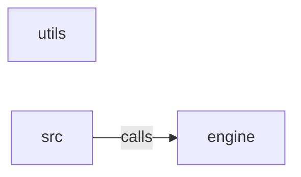

_Generated by CodeAtlas._

## Details

Owns 231 symbols across 2 file(s).

### engine

Owns 1370 symbols across 33 file(s).

**Related Classes/Methods:** _None_

**Source Files:**

- `src/engine/activation.rs`
  - `src.engine.activation.ActivationEngine`
  - `src.engine.activation.ActivationEngine.build_payload`
  - `src.engine.activation.ActivationEngine.calculate_stats`
  - `src.engine.activation.ActivationEngine.deduplicate_messages`
  - `src.engine.activation.ActivationEngine.format_for_platform`
  - `src.engine.activation.ActivationEngine.get_platform_endpoint`
  - `src.engine.activation.ActivationEngine.is_eligible`
  - `src.engine.activation.ActivationEngine.validate_for_platform`
  - `src.engine.activation.ActivationEvent`
  - `src.engine.activation.ActivationMessage`
  - `src.engine.activation.ActivationMessage.new`
  - `src.engine.activation.ActivationMessage.with_property`
  - `src.engine.activation.ActivationResult`
  - `src.engine.activation.ActivationResult.failure`
  - `src.engine.activation.ActivationResult.success`
  - `src.engine.activation.ActivationStats`
  - `src.engine.activation.ActivationStats.default`
  - `src.engine.activation.BatchActivationConfig`
  - `src.engine.activation.BatchActivationConfig.default`
  - `src.engine.activation.CustomerRecord`
  - `src.engine.activation.Platform`
  - `src.engine.activation.Platform.as_str`
  - `src.engine.activation.PlatformCredential`
  - `src.engine.activation.PlatformCredential.new`
  - `src.engine.activation.PlatformCredential.with_endpoint`
  - `src.engine.activation.PlatformCredential.with_secret`
  - `src.engine.activation.PlatformCredential.with_workspace`
  - `src.engine.activation.WebhookTrigger`
  - `src.engine.activation.WebhookTrigger.new`
  - `src.engine.activation.WebhookTrigger.with_header`
  - `src.engine.activation.tests.create_test_customer`
  - `src.engine.activation.tests.test_activation_message_creation`
  - `src.engine.activation.tests.test_activation_result_failure`
  - `src.engine.activation.tests.test_activation_result_success`
  - `src.engine.activation.tests.test_batch_config_defaults`
  - `src.engine.activation.tests.test_build_payload`
  - `src.engine.activation.tests.test_calculate_stats`
  - `src.engine.activation.tests.test_deduplicate_messages`
  - `src.engine.activation.tests.test_format_for_braze`
  - `src.engine.activation.tests.test_format_for_klaviyo`
  - `src.engine.activation.tests.test_is_eligible`
  - `src.engine.activation.tests.test_platform_credential_creation`
  - `src.engine.activation.tests.test_validate_for_platform`
  - `src.engine.activation.tests.test_webhook_trigger_creation`
- `src/engine/activation_orchestrator.rs`
  - `src.engine.activation_orchestrator.ActivationOrchestrator`
  - `src.engine.activation_orchestrator.ActivationOrchestrator.clear_results`
  - `src.engine.activation_orchestrator.ActivationOrchestrator.get_platform`
  - `src.engine.activation_orchestrator.ActivationOrchestrator.get_results`
  - `src.engine.activation_orchestrator.ActivationOrchestrator.get_stats`
  - `src.engine.activation_orchestrator.ActivationOrchestrator.has_platform`
  - `src.engine.activation_orchestrator.ActivationOrchestrator.new`
  - `src.engine.activation_orchestrator.ActivationOrchestrator.platform_count`
  - `src.engine.activation_orchestrator.ActivationOrchestrator.process_batch`
  - `src.engine.activation_orchestrator.ActivationOrchestrator.process_message`
  - `src.engine.activation_orchestrator.ActivationOrchestrator.register_platform`
  - `src.engine.activation_orchestrator.ActivationOrchestrator.success_rate`
  - `src.engine.activation_orchestrator.ActivationQueue`
  - `src.engine.activation_orchestrator.ActivationQueue.clear`
  - `src.engine.activation_orchestrator.ActivationQueue.flush`
  - `src.engine.activation_orchestrator.ActivationQueue.is_full`
  - `src.engine.activation_orchestrator.ActivationQueue.new`
  - `src.engine.activation_orchestrator.ActivationQueue.push`
  - `src.engine.activation_orchestrator.ActivationQueue.size`
  - `src.engine.activation_orchestrator.RetryPolicy`
  - `src.engine.activation_orchestrator.RetryPolicy.default`
  - `src.engine.activation_orchestrator.SegmentActivationManager`
  - `src.engine.activation_orchestrator.SegmentActivationManager.activate_segment`
  - `src.engine.activation_orchestrator.SegmentActivationManager.deactivate_segment`
  - `src.engine.activation_orchestrator.SegmentActivationManager.update_attributes`
  - `src.engine.activation_orchestrator.WebhookManager`
  - `src.engine.activation_orchestrator.WebhookManager.active_trigger_count`
  - `src.engine.activation_orchestrator.WebhookManager.default`
  - `src.engine.activation_orchestrator.WebhookManager.get_triggers`
  - `src.engine.activation_orchestrator.WebhookManager.new`
  - `src.engine.activation_orchestrator.WebhookManager.register_trigger`
  - `src.engine.activation_orchestrator.WebhookManager.trigger_count`
  - `src.engine.activation_orchestrator.tests.create_test_customer`
  - `src.engine.activation_orchestrator.tests.test_activation_queue`
  - `src.engine.activation_orchestrator.tests.test_orchestrator_process_batch`
  - `src.engine.activation_orchestrator.tests.test_orchestrator_register_platform`
  - `src.engine.activation_orchestrator.tests.test_orchestrator_stats`
  - `src.engine.activation_orchestrator.tests.test_queue_capacity`
  - `src.engine.activation_orchestrator.tests.test_queue_flush`
  - `src.engine.activation_orchestrator.tests.test_retry_policy_default`
  - `src.engine.activation_orchestrator.tests.test_segment_activation_manager`
  - `src.engine.activation_orchestrator.tests.test_segment_deactivation`
  - `src.engine.activation_orchestrator.tests.test_success_rate`
  - `src.engine.activation_orchestrator.tests.test_update_attributes`
  - `src.engine.activation_orchestrator.tests.test_webhook_get_triggers`
  - `src.engine.activation_orchestrator.tests.test_webhook_manager`
- `src/engine/algorithms.rs`
  - `src.engine.algorithms.DBSCAN`
  - `src.engine.algorithms.DBSCAN.expand_cluster`
  - `src.engine.algorithms.DBSCAN.fit`
  - `src.engine.algorithms.DBSCAN.get_neighbors`
  - `src.engine.algorithms.DBSCAN.new`
  - `src.engine.algorithms.DBSCANResult`
  - `src.engine.algorithms.DistanceMetric`
  - `src.engine.algorithms.DistanceMetric.distance`
  - `src.engine.algorithms.GMMResult`
  - `src.engine.algorithms.GaussianMixture`
  - `src.engine.algorithms.GaussianMixture.fit`
  - `src.engine.algorithms.GaussianMixture.new`
  - `src.engine.algorithms.HierarchicalClustering`
  - `src.engine.algorithms.HierarchicalClustering.fit`
  - `src.engine.algorithms.HierarchicalClustering.new`
  - `src.engine.algorithms.HierarchicalResult`
  - `src.engine.algorithms.KMeans`
  - `src.engine.algorithms.KMeans.fit`
  - `src.engine.algorithms.KMeans.new`
  - `src.engine.algorithms.KMeansResult`
  - `src.engine.algorithms.tests.test_dbscan_clustering`
  - `src.engine.algorithms.tests.test_distance_metrics`
  - `src.engine.algorithms.tests.test_euclidean_distance`
  - `src.engine.algorithms.tests.test_gmm_clustering`
  - `src.engine.algorithms.tests.test_hierarchical_clustering`
  - `src.engine.algorithms.tests.test_kmeans_clustering`
  - `src.engine.algorithms.tests.test_manhattan_distance`
- `src/engine/b2b_governance.rs`
  - `src.engine.b2b_governance.AccessControlList`
  - `src.engine.b2b_governance.AccessController`
  - `src.engine.b2b_governance.AccessController.manage_access`
  - `src.engine.b2b_governance.AccessGrant`
  - `src.engine.b2b_governance.AccountHealth`
  - `src.engine.b2b_governance.AccountHierarchy`
  - `src.engine.b2b_governance.AdvancedSimulator`
  - `src.engine.b2b_governance.AdvancedSimulator.simulate_with_constraints`
  - `src.engine.b2b_governance.AggregatedIntent`
  - `src.engine.b2b_governance.AuditEvent`
  - `src.engine.b2b_governance.AuditTracker`
  - `src.engine.b2b_governance.AuditTracker.track_decision`
  - `src.engine.b2b_governance.AuditTrail`
  - `src.engine.b2b_governance.BuyingCommittee`
  - `src.engine.b2b_governance.Change`
  - `src.engine.b2b_governance.ChangeLog`
  - `src.engine.b2b_governance.ChangeTracker`
  - `src.engine.b2b_governance.ChangeTracker.track_changes`
  - `src.engine.b2b_governance.CommitteeDetector`
  - `src.engine.b2b_governance.CommitteeDetector.identify_committee`
  - `src.engine.b2b_governance.CommitteeMember`
  - `src.engine.b2b_governance.CompanyNode`
  - `src.engine.b2b_governance.ConstrainedScenario`
  - `src.engine.b2b_governance.ContractManager`
  - `src.engine.b2b_governance.ContractManager.define_contract`
  - `src.engine.b2b_governance.DataLineage`
  - `src.engine.b2b_governance.FeatureProvenance`
  - `src.engine.b2b_governance.FeatureSource`
  - `src.engine.b2b_governance.Genealogist`
  - `src.engine.b2b_governance.Genealogist.track_genealogy`
  - `src.engine.b2b_governance.HealthScorer`
  - `src.engine.b2b_governance.HealthScorer.score_account_health`
  - `src.engine.b2b_governance.HierarchyBuilder`
  - `src.engine.b2b_governance.HierarchyBuilder.build_hierarchy`
  - `src.engine.b2b_governance.ImpactAnalyzer`
  - `src.engine.b2b_governance.ImpactAnalyzer.analyze_change_impact`
  - `src.engine.b2b_governance.ImpactReport`
  - `src.engine.b2b_governance.IntentAggregator`
  - `src.engine.b2b_governance.IntentAggregator.aggregate_intent`
  - `src.engine.b2b_governance.IntentSignal`
  - `src.engine.b2b_governance.LineageEdge`
  - `src.engine.b2b_governance.LineageTracker`
  - `src.engine.b2b_governance.LineageTracker.track_lineage`
  - `src.engine.b2b_governance.OwnershipManager`
  - `src.engine.b2b_governance.OwnershipManager.assign_ownership`
  - `src.engine.b2b_governance.PolicyEnforcer`
  - `src.engine.b2b_governance.PolicyEnforcer.define_policy`
  - `src.engine.b2b_governance.ProvenanceTracker`
  - `src.engine.b2b_governance.ProvenanceTracker.track_feature_provenance`
  - `src.engine.b2b_governance.SegmentContract`
  - `src.engine.b2b_governance.SegmentGenealogy`
  - `src.engine.b2b_governance.SegmentOwner`
  - `src.engine.b2b_governance.SegmentOwnership`
  - `src.engine.b2b_governance.SegmentVersion`
  - `src.engine.b2b_governance.SegmentationPolicy`
  - `src.engine.b2b_governance.tests.test_access_control`
  - `src.engine.b2b_governance.tests.test_account_health`
  - `src.engine.b2b_governance.tests.test_account_hierarchy`
  - `src.engine.b2b_governance.tests.test_advanced_what_if`
  - `src.engine.b2b_governance.tests.test_audit_trail`
  - `src.engine.b2b_governance.tests.test_buying_committee`
  - `src.engine.b2b_governance.tests.test_change_tracking`
  - `src.engine.b2b_governance.tests.test_data_lineage`
  - `src.engine.b2b_governance.tests.test_feature_provenance`
  - `src.engine.b2b_governance.tests.test_hierarchy_subsidiaries`
  - `src.engine.b2b_governance.tests.test_impact_analysis`
  - `src.engine.b2b_governance.tests.test_intent_aggregation`
  - `src.engine.b2b_governance.tests.test_ownership_assignment`
  - `src.engine.b2b_governance.tests.test_policy_enforcement`
  - `src.engine.b2b_governance.tests.test_segment_contract`
  - `src.engine.b2b_governance.tests.test_segment_genealogy`
- `src/engine/b2b_segmentation.rs`
  - `src.engine.b2b_segmentation.AccountEngagement`
  - `src.engine.b2b_segmentation.AccountHealthScore`
  - `src.engine.b2b_segmentation.B2BAccountSegment`
  - `src.engine.b2b_segmentation.B2BSegmentation`
  - `src.engine.b2b_segmentation.B2BSegmentation.calculate_account_health`
  - `src.engine.b2b_segmentation.B2BSegmentation.calculate_adoption_rate`
  - `src.engine.b2b_segmentation.B2BSegmentation.calculate_arr`
  - `src.engine.b2b_segmentation.B2BSegmentation.calculate_industry_fit`
  - `src.engine.b2b_segmentation.B2BSegmentation.calculate_tam`
  - `src.engine.b2b_segmentation.B2BSegmentation.classify_company_size`
  - `src.engine.b2b_segmentation.B2BSegmentation.identify_at_risk_accounts`
  - `src.engine.b2b_segmentation.B2BSegmentation.identify_expansion_opportunities`
  - `src.engine.b2b_segmentation.B2BSegmentation.identify_vip_accounts`
  - `src.engine.b2b_segmentation.B2BSegmentation.score_engagement`
  - `src.engine.b2b_segmentation.B2BSegmentation.segment_accounts`
  - `src.engine.b2b_segmentation.CompanySize`
  - `src.engine.b2b_segmentation.CompanySize.as_str`
  - `src.engine.b2b_segmentation.ExpansionOpportunity`
  - `src.engine.b2b_segmentation.FirmographicProfile`
  - `src.engine.b2b_segmentation.Industry`
  - `src.engine.b2b_segmentation.Region`
  - `src.engine.b2b_segmentation.tests.test_account_health_score`
  - `src.engine.b2b_segmentation.tests.test_at_risk_accounts`
  - `src.engine.b2b_segmentation.tests.test_calculate_adoption_rate`
  - `src.engine.b2b_segmentation.tests.test_calculate_arr`
  - `src.engine.b2b_segmentation.tests.test_classify_company_size`
  - `src.engine.b2b_segmentation.tests.test_company_size_classification`
  - `src.engine.b2b_segmentation.tests.test_expansion_opportunities`
  - `src.engine.b2b_segmentation.tests.test_identify_vip_accounts`
  - `src.engine.b2b_segmentation.tests.test_industry_fit`
  - `src.engine.b2b_segmentation.tests.test_score_engagement`
- `src/engine/behavioral.rs`
  - `src.engine.behavioral.AggregateFunction`
  - `src.engine.behavioral.AggregateFunction.fmt`
  - `src.engine.behavioral.BehavioralRule`
  - `src.engine.behavioral.BehavioralRule.add_condition`
  - `src.engine.behavioral.BehavioralRule.new`
  - `src.engine.behavioral.BehavioralRule.to_sql`
  - `src.engine.behavioral.BehavioralRule.with_logic`
  - `src.engine.behavioral.BehavioralSegment`
  - `src.engine.behavioral.BehavioralSegment.add_rule`
  - `src.engine.behavioral.BehavioralSegment.matches`
  - `src.engine.behavioral.BehavioralSegment.new`
  - `src.engine.behavioral.BehavioralSegment.to_sql`
  - `src.engine.behavioral.BehavioralSegment.with_priority`
  - `src.engine.behavioral.BehavioralSegmenter`
  - `src.engine.behavioral.BehavioralSegmenter.add_segment`
  - `src.engine.behavioral.BehavioralSegmenter.classify`
  - `src.engine.behavioral.BehavioralSegmenter.classify_primary`
  - `src.engine.behavioral.BehavioralSegmenter.default`
  - `src.engine.behavioral.BehavioralSegmenter.export_sql`
  - `src.engine.behavioral.BehavioralSegmenter.get_segment_sql`
  - `src.engine.behavioral.BehavioralSegmenter.new`
  - `src.engine.behavioral.ComparisonOp`
  - `src.engine.behavioral.ComparisonOp.fmt`
  - `src.engine.behavioral.Condition`
  - `src.engine.behavioral.Condition.evaluate`
  - `src.engine.behavioral.Condition.new`
  - `src.engine.behavioral.Condition.to_sql`
  - `src.engine.behavioral.Condition.with_aggregate`
  - `src.engine.behavioral.Condition.with_time_window`
  - `src.engine.behavioral.LogicalOp`
  - `src.engine.behavioral.LogicalOp.fmt`
  - `src.engine.behavioral.RuleValue`
  - `src.engine.behavioral.RuleValue.fmt`
  - `src.engine.behavioral.tests.test_behavioral_rule_and_logic`
  - `src.engine.behavioral.tests.test_behavioral_segment_matching`
  - `src.engine.behavioral.tests.test_comparison_operators`
  - `src.engine.behavioral.tests.test_condition_evaluation`
  - `src.engine.behavioral.tests.test_condition_to_sql`
  - `src.engine.behavioral.tests.test_logical_operators`
  - `src.engine.behavioral.tests.test_rule_with_aggregate`
  - `src.engine.behavioral.tests.test_rule_with_time_window`
  - `src.engine.behavioral.tests.test_segment_sql_generation`
  - `src.engine.behavioral.tests.test_segmenter_classify`
- `src/engine/churn_prediction.rs`
  - `src.engine.churn_prediction.ChurnCohortSummary`
  - `src.engine.churn_prediction.ChurnFeatureImportance`
  - `src.engine.churn_prediction.ChurnModelPerformance`
  - `src.engine.churn_prediction.ChurnModelType`
  - `src.engine.churn_prediction.ChurnModelType.as_str`
  - `src.engine.churn_prediction.ChurnPrediction`
  - `src.engine.churn_prediction.ChurnPredictor`
  - `src.engine.churn_prediction.ChurnPredictor.calculate_feature_importance`
  - `src.engine.churn_prediction.ChurnPredictor.classify_risk_level`
  - `src.engine.churn_prediction.ChurnPredictor.cohort_summary`
  - `src.engine.churn_prediction.ChurnPredictor.estimate_days_until_churn`
  - `src.engine.churn_prediction.ChurnPredictor.evaluate_model_performance`
  - `src.engine.churn_prediction.ChurnPredictor.predict_batch`
  - `src.engine.churn_prediction.ChurnPredictor.predict_ensemble`
  - `src.engine.churn_prediction.ChurnPredictor.predict_logistic`
  - `src.engine.churn_prediction.ChurnPredictor.recommend_retention_action`
  - `src.engine.churn_prediction.ChurnRiskLevel`
  - `src.engine.churn_prediction.ChurnRiskLevel.as_str`
  - `src.engine.churn_prediction.ChurnRiskLevel.threshold`
  - `src.engine.churn_prediction.RetentionAction`
  - `src.engine.churn_prediction.compute_auc_roc`
  - `src.engine.churn_prediction.tests.test_auc_roc_matches_hand_computed_value`
  - `src.engine.churn_prediction.tests.test_auc_roc_no_discrimination`
  - `src.engine.churn_prediction.tests.test_auc_roc_perfect_separation`
  - `src.engine.churn_prediction.tests.test_auc_roc_perfectly_wrong`
  - `src.engine.churn_prediction.tests.test_batch_prediction`
  - `src.engine.churn_prediction.tests.test_churn_prediction_complete`
  - `src.engine.churn_prediction.tests.test_churn_risk_level_thresholds`
  - `src.engine.churn_prediction.tests.test_cohort_summary`
  - `src.engine.churn_prediction.tests.test_days_until_churn`
  - `src.engine.churn_prediction.tests.test_ensemble_prediction`
  - `src.engine.churn_prediction.tests.test_feature_importance`
  - `src.engine.churn_prediction.tests.test_logistic_prediction`
  - `src.engine.churn_prediction.tests.test_model_performance`
  - `src.engine.churn_prediction.tests.test_retention_action`
  - `src.engine.churn_prediction.tests.test_risk_level_classification`
- `src/engine/clustering.rs`
  - `src.engine.clustering.ClusteringMethod`
  - `src.engine.clustering.KMeansResult`
  - `src.engine.clustering.MiniBatchKMeans`
  - `src.engine.clustering.MiniBatchKMeans.centers`
  - `src.engine.clustering.MiniBatchKMeans.is_initialized`
  - `src.engine.clustering.MiniBatchKMeans.new`
  - `src.engine.clustering.MiniBatchKMeans.partial_fit`
  - `src.engine.clustering.MiniBatchKMeans.predict`
  - `src.engine.clustering.assign_to_clusters`
  - `src.engine.clustering.build_thread_pool`
  - `src.engine.clustering.kmeans`
  - `src.engine.clustering.kmeans_plus_plus_init`
  - `src.engine.clustering.kprototypes`
  - `src.engine.clustering.nearest_center`
  - `src.engine.clustering.squared_euclidean`
  - `src.engine.clustering.tests.assign_to_clusters_errors_on_empty_centers`
  - `src.engine.clustering.tests.assign_to_clusters_picks_nearest_center`
  - `src.engine.clustering.tests.kmeans_inertia_matches_hand_computed_value_on_fixed_centers`
  - `src.engine.clustering.tests.kmeans_is_deterministic_for_a_given_seed`
  - `src.engine.clustering.tests.kmeans_n_jobs_does_not_affect_correctness_or_determinism`
  - `src.engine.clustering.tests.kmeans_recovers_well_separated_blobs`
  - `src.engine.clustering.tests.kmeans_rejects_more_clusters_than_points`
  - `src.engine.clustering.tests.kprototypes_mode_tie_breaking_is_deterministic_across_repeated_runs`
  - `src.engine.clustering.tests.kprototypes_n_jobs_does_not_affect_correctness`
  - `src.engine.clustering.tests.kprototypes_separates_by_categorical_distance_when_numeric_is_uninformative`
  - `src.engine.clustering.tests.minibatch_kmeans_empty_chunk_is_a_noop`
  - `src.engine.clustering.tests.minibatch_kmeans_predict_before_any_chunk_errors`
  - `src.engine.clustering.tests.minibatch_kmeans_recovers_well_separated_blobs_from_chunks`
  - `src.engine.clustering.tests.minibatch_kmeans_rejects_first_chunk_smaller_than_n_clusters`
  - `src.engine.clustering.tests.minibatch_kmeans_rejects_mismatched_feature_count_after_init`
  - `src.engine.clustering.tests.minibatch_kmeans_rejects_zero_clusters`
  - `src.engine.clustering.tests.test_clustering_method_variants`
  - `src.engine.clustering.tests.three_blobs`
- `src/engine/clv.rs`
  - `src.engine.clv.CLVCalculator`
  - `src.engine.clv.CLVCalculator.calculate_probabilistic_ltv`
  - `src.engine.clv.CLVCalculator.calculate_segment_clv`
  - `src.engine.clv.CLVCalculator.calculate_simple_ltv`
  - `src.engine.clv.CLVCalculator.predict_churn`
  - `src.engine.clv.CLVCalculator.project_revenue`
  - `src.engine.clv.CLVModel`
  - `src.engine.clv.ChurnPrediction`
  - `src.engine.clv.CustomerLTV`
  - `src.engine.clv.RevenueForecaster`
  - `src.engine.clv.RevenueForecaster.detect_trend`
  - `src.engine.clv.RevenueForecaster.forecast_exponential_smoothing`
  - `src.engine.clv.RevenueForecaster.moving_average`
  - `src.engine.clv.RevenueProjection`
  - `src.engine.clv.tests.test_churn_prediction`
  - `src.engine.clv.tests.test_churn_risk_levels`
  - `src.engine.clv.tests.test_exponential_smoothing`
  - `src.engine.clv.tests.test_ltv_edge_cases`
  - `src.engine.clv.tests.test_moving_average`
  - `src.engine.clv.tests.test_probabilistic_ltv`
  - `src.engine.clv.tests.test_revenue_projection`
  - `src.engine.clv.tests.test_segment_ltv`
  - `src.engine.clv.tests.test_simple_ltv_calculation`
  - `src.engine.clv.tests.test_simple_ltv_churn_probability_varies_with_real_customer_data`
  - `src.engine.clv.tests.test_trend_detection`
- `src/engine/cohorts.rs`
  - `src.engine.cohorts.AnalyticsResult`
  - `src.engine.cohorts.Cohort`
  - `src.engine.cohorts.CohortAnalytics`
  - `src.engine.cohorts.CohortAnalytics.add_retention_point`
  - `src.engine.cohorts.CohortAnalytics.aggregate_by_period`
  - `src.engine.cohorts.CohortAnalytics.cohort_summary`
  - `src.engine.cohorts.CohortAnalytics.compare_cohorts`
  - `src.engine.cohorts.CohortAnalytics.create_cohort`
  - `src.engine.cohorts.CohortAnalytics.performance_ranking`
  - `src.engine.cohorts.CohortAnalytics.retention_decay_rate`
  - `src.engine.cohorts.CohortAnalytics.retention_table`
  - `src.engine.cohorts.CohortAnalytics.revenue_per_retained`
  - `src.engine.cohorts.CohortComparison`
  - `src.engine.cohorts.CohortId`
  - `src.engine.cohorts.CohortId.new`
  - `src.engine.cohorts.CohortPeriod`
  - `src.engine.cohorts.CohortPeriod.days`
  - `src.engine.cohorts.RetentionPoint`
  - `src.engine.cohorts.tests.test_aggregate_by_period`
  - `src.engine.cohorts.tests.test_cohort_comparison`
  - `src.engine.cohorts.tests.test_cohort_creation`
  - `src.engine.cohorts.tests.test_cohort_summary`
  - `src.engine.cohorts.tests.test_decay_rate`
  - `src.engine.cohorts.tests.test_performance_ranking`
  - `src.engine.cohorts.tests.test_retention_curve`
  - `src.engine.cohorts.tests.test_retention_table`
  - `src.engine.cohorts.tests.test_revenue_per_retained`
- `src/engine/dashboard.rs`
  - `src.engine.dashboard.DashboardData`
  - `src.engine.dashboard.DashboardMetrics`
  - `src.engine.dashboard.DashboardMetrics.build_summary`
  - `src.engine.dashboard.DashboardMetrics.calculate_health_summary`
  - `src.engine.dashboard.DashboardMetrics.calculate_metrics_point`
  - `src.engine.dashboard.DashboardMetrics.calculate_trend`
  - `src.engine.dashboard.DashboardMetrics.classify_segment_health`
  - `src.engine.dashboard.DashboardMetrics.compare_segments`
  - `src.engine.dashboard.DashboardMetrics.create_kpi`
  - `src.engine.dashboard.DashboardMetrics.create_segment_card`
  - `src.engine.dashboard.DashboardMetrics.create_streaming_metrics`
  - `src.engine.dashboard.DashboardProvider`
  - `src.engine.dashboard.DashboardProvider.export_summary`
  - `src.engine.dashboard.DashboardProvider.generate_dashboard`
  - `src.engine.dashboard.DashboardSummary`
  - `src.engine.dashboard.DriftAlertSummary`
  - `src.engine.dashboard.KPI`
  - `src.engine.dashboard.MetricsPoint`
  - `src.engine.dashboard.SegmentCard`
  - `src.engine.dashboard.SegmentComparison`
  - `src.engine.dashboard.SegmentHealthSummary`
  - `src.engine.dashboard.StreamingMetrics`
  - `src.engine.dashboard.TimeRange`
  - `src.engine.dashboard.TimeRange.seconds`
  - `src.engine.dashboard.Trend`
  - `src.engine.dashboard.Trend.as_str`
  - `src.engine.dashboard.tests.test_dashboard_generation`
  - `src.engine.dashboard.tests.test_drift_alert_summary`
  - `src.engine.dashboard.tests.test_export_summary`
  - `src.engine.dashboard.tests.test_health_summary`
  - `src.engine.dashboard.tests.test_kpi_creation`
  - `src.engine.dashboard.tests.test_metrics_point`
  - `src.engine.dashboard.tests.test_segment_card_creation`
  - `src.engine.dashboard.tests.test_segment_comparison`
  - `src.engine.dashboard.tests.test_segment_health_classification`
  - `src.engine.dashboard.tests.test_streaming_metrics`
  - `src.engine.dashboard.tests.test_summary_creation`
  - `src.engine.dashboard.tests.test_time_range`
  - `src.engine.dashboard.tests.test_trend_classification`
- `src/engine/drift_detection.rs`
  - `src.engine.drift_detection.DistributionStats`
  - `src.engine.drift_detection.DistributionStats.new`
  - `src.engine.drift_detection.DriftAlert`
  - `src.engine.drift_detection.DriftAlert.new`
  - `src.engine.drift_detection.DriftDetector`
  - `src.engine.drift_detection.DriftDetector.chi_square`
  - `src.engine.drift_detection.DriftDetector.detect_batch_drift`
  - `src.engine.drift_detection.DriftDetector.detect_feature_drift`
  - `src.engine.drift_detection.DriftDetector.detect_segment_composition_change`
  - `src.engine.drift_detection.DriftDetector.get_drifted_features`
  - `src.engine.drift_detection.DriftDetector.has_critical_drift`
  - `src.engine.drift_detection.DriftDetector.hellinger_distance`
  - `src.engine.drift_detection.DriftDetector.kolmogorov_smirnov`
  - `src.engine.drift_detection.DriftMethod`
  - `src.engine.drift_detection.DriftSeverity`
  - `src.engine.drift_detection.DriftSeverity.as_str`
  - `src.engine.drift_detection.DriftSeverity.threshold`
  - `src.engine.drift_detection.FeatureDrift`
  - `src.engine.drift_detection.SegmentCompositionChange`
  - `src.engine.drift_detection.tests.test_chi_square`
  - `src.engine.drift_detection.tests.test_chi_square_drift_method_is_not_a_hardcoded_zero`
  - `src.engine.drift_detection.tests.test_detect_feature_drift`
  - `src.engine.drift_detection.tests.test_distribution_stats`
  - `src.engine.drift_detection.tests.test_distribution_stats_empty`
  - `src.engine.drift_detection.tests.test_drift_alert_creation`
  - `src.engine.drift_detection.tests.test_drift_severity_classification`
  - `src.engine.drift_detection.tests.test_drift_severity_thresholds`
  - `src.engine.drift_detection.tests.test_get_drifted_features`
  - `src.engine.drift_detection.tests.test_has_critical_drift`
  - `src.engine.drift_detection.tests.test_hellinger_distance`
  - `src.engine.drift_detection.tests.test_hellinger_distance_degenerate_baseline_and_current_at_same_point_is_zero`
  - `src.engine.drift_detection.tests.test_hellinger_distance_degenerate_baseline_vs_shifted_current_is_not_zero`
  - `src.engine.drift_detection.tests.test_hellinger_distance_reacts_to_variance_difference_alone`
  - `src.engine.drift_detection.tests.test_ks_test_detects_real_drift_even_with_ties_present`
  - `src.engine.drift_detection.tests.test_ks_test_no_drift`
  - `src.engine.drift_detection.tests.test_ks_test_no_drift_with_tied_repeated_values`
  - `src.engine.drift_detection.tests.test_ks_test_with_drift`
  - `src.engine.drift_detection.tests.test_segment_composition_change`
- `src/engine/governance.rs`
  - `src.engine.governance.Action`
  - `src.engine.governance.Action.as_str`
  - `src.engine.governance.AuditEvent`
  - `src.engine.governance.AuditEvent.denied`
  - `src.engine.governance.AuditEvent.failure`
  - `src.engine.governance.AuditEvent.new`
  - `src.engine.governance.AuditEvent.success`
  - `src.engine.governance.AuditEvent.with_detail`
  - `src.engine.governance.AuditLog`
  - `src.engine.governance.AuditLog.default`
  - `src.engine.governance.AuditLog.event_count`
  - `src.engine.governance.AuditLog.get_denied_actions`
  - `src.engine.governance.AuditLog.get_events`
  - `src.engine.governance.AuditLog.get_resource_events`
  - `src.engine.governance.AuditLog.get_user_events`
  - `src.engine.governance.AuditLog.new`
  - `src.engine.governance.AuditLog.record`
  - `src.engine.governance.Permission`
  - `src.engine.governance.Permission.new`
  - `src.engine.governance.RBACManager`
  - `src.engine.governance.RBACManager.can_user_perform`
  - `src.engine.governance.RBACManager.check_permission`
  - `src.engine.governance.RBACManager.deactivate_user`
  - `src.engine.governance.RBACManager.default`
  - `src.engine.governance.RBACManager.get_user`
  - `src.engine.governance.RBACManager.grant_permission`
  - `src.engine.governance.RBACManager.list_users`
  - `src.engine.governance.RBACManager.new`
  - `src.engine.governance.RBACManager.register_user`
  - `src.engine.governance.RBACManager.revoke_permission`
  - `src.engine.governance.RBACManager.set_default_permissions`
  - `src.engine.governance.Resource`
  - `src.engine.governance.Resource.as_str`
  - `src.engine.governance.Role`
  - `src.engine.governance.Role.as_str`
  - `src.engine.governance.User`
  - `src.engine.governance.User.new`
  - `src.engine.governance.tests.test_audit_event`
  - `src.engine.governance.tests.test_audit_event_denied`
  - `src.engine.governance.tests.test_audit_log`
  - `src.engine.governance.tests.test_audit_log_filtering`
  - `src.engine.governance.tests.test_grant_revoke_permission`
  - `src.engine.governance.tests.test_list_users`
  - `src.engine.governance.tests.test_permission_creation`
  - `src.engine.governance.tests.test_rbac_manager_admin`
  - `src.engine.governance.tests.test_rbac_manager_viewer`
  - `src.engine.governance.tests.test_role_string`
  - `src.engine.governance.tests.test_user_creation`
  - `src.engine.governance.tests.test_user_deactivation`
- `src/engine/heuristic_score_estimator.rs`
  - `src.engine.heuristic_score_estimator.EstimationResult`
  - `src.engine.heuristic_score_estimator.EstimatorTaskType`
  - `src.engine.heuristic_score_estimator.EstimatorTaskType.as_str`
  - `src.engine.heuristic_score_estimator.FeatureEngineering`
  - `src.engine.heuristic_score_estimator.FeatureEngineering.normalize`
  - `src.engine.heuristic_score_estimator.FeatureEngineering.polynomial_features`
  - `src.engine.heuristic_score_estimator.FeatureEngineering.select_high_variance_features`
  - `src.engine.heuristic_score_estimator.FeatureEngineering.standardize`
  - `src.engine.heuristic_score_estimator.FeatureImportance`
  - `src.engine.heuristic_score_estimator.HeuristicEstimatorParams`
  - `src.engine.heuristic_score_estimator.HeuristicEstimatorParams.default`
  - `src.engine.heuristic_score_estimator.HeuristicEstimatorParams.new`
  - `src.engine.heuristic_score_estimator.HeuristicEstimatorParams.with_learning_rate`
  - `src.engine.heuristic_score_estimator.HeuristicEstimatorParams.with_max_depth`
  - `src.engine.heuristic_score_estimator.HeuristicEstimatorParams.with_n_estimators`
  - `src.engine.heuristic_score_estimator.HeuristicEstimatorParams.with_regularization`
  - `src.engine.heuristic_score_estimator.HeuristicPrediction`
  - `src.engine.heuristic_score_estimator.HeuristicScoreEstimator`
  - `src.engine.heuristic_score_estimator.HeuristicScoreEstimator.get_feature_importance`
  - `src.engine.heuristic_score_estimator.HeuristicScoreEstimator.get_top_features`
  - `src.engine.heuristic_score_estimator.HeuristicScoreEstimator.new`
  - `src.engine.heuristic_score_estimator.HeuristicScoreEstimator.predict`
  - `src.engine.heuristic_score_estimator.HeuristicScoreEstimator.train`
  - `src.engine.heuristic_score_estimator.HeuristicScoreEstimator.with_features`
  - `src.engine.heuristic_score_estimator.tests.test_feature_importance`
  - `src.engine.heuristic_score_estimator.tests.test_high_variance_features`
  - `src.engine.heuristic_score_estimator.tests.test_normalize`
  - `src.engine.heuristic_score_estimator.tests.test_polynomial_features`
  - `src.engine.heuristic_score_estimator.tests.test_standardize`
  - `src.engine.heuristic_score_estimator.tests.test_untrained_predict`
  - `src.engine.heuristic_score_estimator.tests.test_xgb_model_creation`
  - `src.engine.heuristic_score_estimator.tests.test_xgb_model_type`
  - `src.engine.heuristic_score_estimator.tests.test_xgb_params`
  - `src.engine.heuristic_score_estimator.tests.test_xgb_prediction`
  - `src.engine.heuristic_score_estimator.tests.test_xgb_training`
- `src/engine/k_estimation.rs`
  - `src.engine.k_estimation.CombinedKEstimation`
  - `src.engine.k_estimation.CombinedKEstimation.estimate`
  - `src.engine.k_estimation.ElbowMethod`
  - `src.engine.k_estimation.ElbowMethod.estimate`
  - `src.engine.k_estimation.GapStatistic`
  - `src.engine.k_estimation.GapStatistic.calculate_reference_dispersion`
  - `src.engine.k_estimation.GapStatistic.estimate`
  - `src.engine.k_estimation.KEstimationResult`
  - `src.engine.k_estimation.SilhouetteEstimation`
  - `src.engine.k_estimation.SilhouetteEstimation.calculate_silhouette_score`
  - `src.engine.k_estimation.SilhouetteEstimation.estimate`
  - `src.engine.k_estimation.tests.test_combined_estimation`
  - `src.engine.k_estimation.tests.test_elbow_method`
  - `src.engine.k_estimation.tests.test_gap_statistic`
  - `src.engine.k_estimation.tests.test_k_range_validation`
  - `src.engine.k_estimation.tests.test_silhouette_estimation`
  - `src.engine.k_estimation.tests.test_silhouette_score`
- `src/engine/lifecycle.rs`
  - `src.engine.lifecycle.JourneyEvent`
  - `src.engine.lifecycle.LifecycleProfile`
  - `src.engine.lifecycle.LifecycleStage`
  - `src.engine.lifecycle.LifecycleStage.as_str`
  - `src.engine.lifecycle.LifecycleStage.to_index`
  - `src.engine.lifecycle.LifecycleTracker`
  - `src.engine.lifecycle.LifecycleTracker.build_transition_matrix`
  - `src.engine.lifecycle.LifecycleTracker.classify_stage`
  - `src.engine.lifecycle.LifecycleTracker.identify_vip_at_risk`
  - `src.engine.lifecycle.LifecycleTracker.predict_next_stage`
  - `src.engine.lifecycle.LifecycleTracker.retention_actions`
  - `src.engine.lifecycle.LifecycleTracker.stage_distribution`
  - `src.engine.lifecycle.LifecycleTracker.time_to_next_stage`
  - `src.engine.lifecycle.StageTransition`
  - `src.engine.lifecycle.tests.test_classify_active`
  - `src.engine.lifecycle.tests.test_classify_at_risk`
  - `src.engine.lifecycle.tests.test_classify_dormant`
  - `src.engine.lifecycle.tests.test_classify_mature`
  - `src.engine.lifecycle.tests.test_classify_onboarding`
  - `src.engine.lifecycle.tests.test_classify_prospect`
  - `src.engine.lifecycle.tests.test_lifecycle_stage_index`
  - `src.engine.lifecycle.tests.test_retention_actions_variety`
  - `src.engine.lifecycle.tests.test_stage_distribution`
  - `src.engine.lifecycle.tests.test_vip_at_risk`
- `src/engine/lookalike.rs`
  - `src.engine.lookalike.LookalikeAudience`
  - `src.engine.lookalike.LookalikeCandidate`
  - `src.engine.lookalike.LookalikeGenerator`
  - `src.engine.lookalike.LookalikeGenerator.calculate_average_categorical`
  - `src.engine.lookalike.LookalikeGenerator.calculate_average_features`
  - `src.engine.lookalike.LookalikeGenerator.cosine_similarity`
  - `src.engine.lookalike.LookalikeGenerator.euclidean_distance`
  - `src.engine.lookalike.LookalikeGenerator.euclidean_to_similarity`
  - `src.engine.lookalike.LookalikeGenerator.find_similar_customers`
  - `src.engine.lookalike.LookalikeGenerator.generate_lookalike`
  - `src.engine.lookalike.LookalikeGenerator.jaccard_similarity`
  - `src.engine.lookalike.LookalikeGenerator.manhattan_distance`
  - `src.engine.lookalike.SeedCustomer`
  - `src.engine.lookalike.SimilarityMetric`
  - `src.engine.lookalike.SimilarityMetric.as_str`
  - `src.engine.lookalike.tests.create_seed_customer`
  - `src.engine.lookalike.tests.test_cosine_similarity`
  - `src.engine.lookalike.tests.test_euclidean_distance`
  - `src.engine.lookalike.tests.test_find_similar_customers`
  - `src.engine.lookalike.tests.test_generate_lookalike`
  - `src.engine.lookalike.tests.test_jaccard_similarity`
  - `src.engine.lookalike.tests.test_lookalike_audience_metrics`
  - `src.engine.lookalike.tests.test_manhattan_distance`
  - `src.engine.lookalike.tests.test_percentile_filtering`
  - `src.engine.lookalike.tests.test_percentile_filtering_is_order_independent`
  - `src.engine.lookalike.tests.test_similarity_metric_names`
- `src/engine/mod.rs`
  - `src.engine.mod.AudienceSegmenterCore`
  - `src.engine.mod.AudienceSegmenterCore.fit`
  - `src.engine.mod.AudienceSegmenterCore.new`
  - `src.engine.mod.AudienceSegmenterCore.predict`
  - `src.engine.mod.NormalizationParams`
  - `src.engine.mod.SegmenterConfig`
  - `src.engine.mod.tests.fit_then_predict_round_trips_through_real_kmeans`
  - `src.engine.mod.tests.fit_with_kprototypes_falls_back_to_numeric_only_and_still_produces_centers`
  - `src.engine.mod.tests.make_config`
  - `src.engine.mod.tests.predict_before_fit_returns_a_clear_error_not_an_empty_result`
  - `src.engine.mod.tests.segmenter_with_explicit_n_jobs_constructs_fits_and_predicts_correctly`
  - `src.engine.mod.tests.test_segmenter_creation`
- `src/engine/neural_networks.rs`
  - `src.engine.neural_networks.Activation`
  - `src.engine.neural_networks.Activation.apply`
  - `src.engine.neural_networks.Activation.as_str`
  - `src.engine.neural_networks.Activation.derivative`
  - `src.engine.neural_networks.Autoencoder`
  - `src.engine.neural_networks.Autoencoder.anomaly_scores`
  - `src.engine.neural_networks.Autoencoder.decode`
  - `src.engine.neural_networks.Autoencoder.encode`
  - `src.engine.neural_networks.Autoencoder.extract_patterns`
  - `src.engine.neural_networks.Autoencoder.new`
  - `src.engine.neural_networks.Autoencoder.reconstruct`
  - `src.engine.neural_networks.Autoencoder.train`
  - `src.engine.neural_networks.Autoencoder.with_features`
  - `src.engine.neural_networks.DenseLayer`
  - `src.engine.neural_networks.DenseLayer.backward`
  - `src.engine.neural_networks.DenseLayer.forward`
  - `src.engine.neural_networks.DenseLayer.new`
  - `src.engine.neural_networks.DenseLayer.update_weights`
  - `src.engine.neural_networks.NNConfig`
  - `src.engine.neural_networks.NNConfig.default`
  - `src.engine.neural_networks.NNConfig.with_dropout`
  - `src.engine.neural_networks.NNConfig.with_epochs`
  - `src.engine.neural_networks.NNConfig.with_hidden_layers`
  - `src.engine.neural_networks.NNConfig.with_learning_rate`
  - `src.engine.neural_networks.NeuralNetwork`
  - `src.engine.neural_networks.NeuralNetwork.backpropagate`
  - `src.engine.neural_networks.NeuralNetwork.layer_info`
  - `src.engine.neural_networks.NeuralNetwork.new`
  - `src.engine.neural_networks.NeuralNetwork.predict`
  - `src.engine.neural_networks.NeuralNetwork.train`
  - `src.engine.neural_networks.NeuralNetwork.with_features`
  - `src.engine.neural_networks.RecurrentLayer`
  - `src.engine.neural_networks.RecurrentLayer.new`
  - `src.engine.neural_networks.RecurrentLayer.process_sequence`
  - `src.engine.neural_networks.RecurrentLayer.reset`
  - `src.engine.neural_networks.RecurrentLayer.step`
  - `src.engine.neural_networks.TrainingStats`
  - `src.engine.neural_networks.tests.test_activation_derivative`
  - `src.engine.neural_networks.tests.test_activation_relu`
  - `src.engine.neural_networks.tests.test_activation_sigmoid`
  - `src.engine.neural_networks.tests.test_autoencoder_anomaly_scores`
  - `src.engine.neural_networks.tests.test_autoencoder_creation`
  - `src.engine.neural_networks.tests.test_autoencoder_encode_decode`
  - `src.engine.neural_networks.tests.test_autoencoder_extract_patterns`
  - `src.engine.neural_networks.tests.test_autoencoder_reconstruct`
  - `src.engine.neural_networks.tests.test_config_builder`
  - `src.engine.neural_networks.tests.test_dense_layer_creation`
  - `src.engine.neural_networks.tests.test_dense_layer_forward`
  - `src.engine.neural_networks.tests.test_neural_network_creation`
  - `src.engine.neural_networks.tests.test_neural_network_predict`
  - `src.engine.neural_networks.tests.test_neural_network_training`
  - `src.engine.neural_networks.tests.test_nn_layer_info`
  - `src.engine.neural_networks.tests.test_nn_with_features`
  - `src.engine.neural_networks.tests.test_recurrent_layer_creation`
  - `src.engine.neural_networks.tests.test_recurrent_layer_sequence`
  - `src.engine.neural_networks.tests.test_recurrent_layer_step`
- `src/engine/pattern_discovery.rs`
  - `src.engine.pattern_discovery.AiPersona`
  - `src.engine.pattern_discovery.AiPersona.add_action`
  - `src.engine.pattern_discovery.AiPersona.add_characteristic`
  - `src.engine.pattern_discovery.AiPersona.new`
  - `src.engine.pattern_discovery.AiPersona.set_impact`
  - `src.engine.pattern_discovery.AiPersona.with_description`
  - `src.engine.pattern_discovery.CausalDriver`
  - `src.engine.pattern_discovery.CausalDriver.add_affected_segment`
  - `src.engine.pattern_discovery.CausalDriver.is_significant`
  - `src.engine.pattern_discovery.CausalDriver.new`
  - `src.engine.pattern_discovery.CausalDriver.with_mechanism`
  - `src.engine.pattern_discovery.CustomerTribe`
  - `src.engine.pattern_discovery.CustomerTribe.add_value`
  - `src.engine.pattern_discovery.CustomerTribe.new`
  - `src.engine.pattern_discovery.CustomerTribe.set_influence`
  - `src.engine.pattern_discovery.DiscoveredLifecycle`
  - `src.engine.pattern_discovery.DiscoveredLifecycle.add_behavior`
  - `src.engine.pattern_discovery.DiscoveredLifecycle.new`
  - `src.engine.pattern_discovery.EmergingAudience`
  - `src.engine.pattern_discovery.EmergingAudience.new`
  - `src.engine.pattern_discovery.GrowthForecast`
  - `src.engine.pattern_discovery.GrowthForecast.from_historical`
  - `src.engine.pattern_discovery.HiddenOpportunity`
  - `src.engine.pattern_discovery.HiddenOpportunity.new`
  - `src.engine.pattern_discovery.HiddenOpportunity.set_type`
  - `src.engine.pattern_discovery.IntentCluster`
  - `src.engine.pattern_discovery.IntentCluster.add_signal`
  - `src.engine.pattern_discovery.IntentCluster.calculate_confidence`
  - `src.engine.pattern_discovery.IntentCluster.new`
  - `src.engine.pattern_discovery.MicroCommunity`
  - `src.engine.pattern_discovery.MicroCommunity.add_characteristic`
  - `src.engine.pattern_discovery.MicroCommunity.is_vibrant`
  - `src.engine.pattern_discovery.MicroCommunity.new`
  - `src.engine.pattern_discovery.PatternDiscovery`
  - `src.engine.pattern_discovery.PatternDiscovery.analyze_trends`
  - `src.engine.pattern_discovery.PatternDiscovery.detect_emerging_audiences`
  - `src.engine.pattern_discovery.PatternDiscovery.detect_micro_communities`
  - `src.engine.pattern_discovery.PatternDiscovery.discover_hidden_opportunities`
  - `src.engine.pattern_discovery.PatternDiscovery.discover_intent_clusters`
  - `src.engine.pattern_discovery.PatternDiscovery.discover_lifecycle_stages`
  - `src.engine.pattern_discovery.PatternDiscovery.discover_product_affinities`
  - `src.engine.pattern_discovery.PatternDiscovery.discover_tribes`
  - `src.engine.pattern_discovery.PatternDiscovery.extract_causal_drivers`
  - `src.engine.pattern_discovery.PatternDiscovery.forecast_growth`
  - `src.engine.pattern_discovery.PatternDiscovery.generate_personas`
  - `src.engine.pattern_discovery.PatternDiscovery.infer_persona_name`
  - `src.engine.pattern_discovery.ProductAffinity`
  - `src.engine.pattern_discovery.ProductAffinity.add_segment`
  - `src.engine.pattern_discovery.ProductAffinity.is_strong_affinity`
  - `src.engine.pattern_discovery.ProductAffinity.new`
  - `src.engine.pattern_discovery.SegmentTrend`
  - `src.engine.pattern_discovery.SegmentTrend.from_time_series`
  - `src.engine.pattern_discovery.tests.test_ai_persona_creation`
  - `src.engine.pattern_discovery.tests.test_causal_driver_churn`
  - `src.engine.pattern_discovery.tests.test_causal_driver_not_significant`
  - `src.engine.pattern_discovery.tests.test_causal_driver_with_mechanism`
  - `src.engine.pattern_discovery.tests.test_customer_tribe`
  - `src.engine.pattern_discovery.tests.test_detect_communities`
  - `src.engine.pattern_discovery.tests.test_detect_emerging`
  - `src.engine.pattern_discovery.tests.test_discover_affinities`
  - `src.engine.pattern_discovery.tests.test_discover_intents`
  - `src.engine.pattern_discovery.tests.test_discover_lifecycle_stages`
  - `src.engine.pattern_discovery.tests.test_discover_opportunities`
  - `src.engine.pattern_discovery.tests.test_discover_tribes_test`
  - `src.engine.pattern_discovery.tests.test_emerging_audience_accelerating`
  - `src.engine.pattern_discovery.tests.test_emerging_audience_plateauing`
  - `src.engine.pattern_discovery.tests.test_extract_drivers`
  - `src.engine.pattern_discovery.tests.test_forecast_accuracy`
  - `src.engine.pattern_discovery.tests.test_generate_personas`
  - `src.engine.pattern_discovery.tests.test_growth_forecast_accelerating`
  - `src.engine.pattern_discovery.tests.test_growth_forecast_decelerating`
  - `src.engine.pattern_discovery.tests.test_hidden_opportunity_high_ltv_low_engagement`
  - `src.engine.pattern_discovery.tests.test_hidden_opportunity_type`
  - `src.engine.pattern_discovery.tests.test_intent_cluster`
  - `src.engine.pattern_discovery.tests.test_lifecycle_discovery`
  - `src.engine.pattern_discovery.tests.test_micro_community_characteristics`
  - `src.engine.pattern_discovery.tests.test_micro_community_vibrant`
  - `src.engine.pattern_discovery.tests.test_persona_impact_high`
  - `src.engine.pattern_discovery.tests.test_persona_with_actions`
  - `src.engine.pattern_discovery.tests.test_product_affinity`
  - `src.engine.pattern_discovery.tests.test_product_affinity_weak`
  - `src.engine.pattern_discovery.tests.test_segment_trend_decreasing`
  - `src.engine.pattern_discovery.tests.test_segment_trend_increasing`
  - `src.engine.pattern_discovery.tests.test_segment_trend_stable`
- `src/engine/platform_adapters.rs`
  - `src.engine.platform_adapters.AdapterFactory`
  - `src.engine.platform_adapters.AdapterFactory.create_adapter`
  - `src.engine.platform_adapters.BrazeAdapter`
  - `src.engine.platform_adapters.BrazeAdapter.format_event`
  - `src.engine.platform_adapters.BrazeAdapter.get_auth_header`
  - `src.engine.platform_adapters.BrazeAdapter.get_endpoint`
  - `src.engine.platform_adapters.BrazeAdapter.new`
  - `src.engine.platform_adapters.CustomAdapter`
  - `src.engine.platform_adapters.CustomAdapter.format_event`
  - `src.engine.platform_adapters.CustomAdapter.get_auth_header`
  - `src.engine.platform_adapters.CustomAdapter.get_endpoint`
  - `src.engine.platform_adapters.CustomAdapter.new`
  - `src.engine.platform_adapters.HubSpotAdapter`
  - `src.engine.platform_adapters.HubSpotAdapter.format_event`
  - `src.engine.platform_adapters.HubSpotAdapter.get_auth_header`
  - `src.engine.platform_adapters.HubSpotAdapter.get_endpoint`
  - `src.engine.platform_adapters.HubSpotAdapter.new`
  - `src.engine.platform_adapters.IterableAdapter`
  - `src.engine.platform_adapters.IterableAdapter.format_event`
  - `src.engine.platform_adapters.IterableAdapter.get_auth_header`
  - `src.engine.platform_adapters.IterableAdapter.get_endpoint`
  - `src.engine.platform_adapters.IterableAdapter.new`
  - `src.engine.platform_adapters.KlaviyoAdapter`
  - `src.engine.platform_adapters.KlaviyoAdapter.format_event`
  - `src.engine.platform_adapters.KlaviyoAdapter.get_auth_header`
  - `src.engine.platform_adapters.KlaviyoAdapter.get_endpoint`
  - `src.engine.platform_adapters.KlaviyoAdapter.new`
  - `src.engine.platform_adapters.PlatformAdapter`
  - `src.engine.platform_adapters.RudderStackAdapter`
  - `src.engine.platform_adapters.RudderStackAdapter.format_event`
  - `src.engine.platform_adapters.RudderStackAdapter.get_auth_header`
  - `src.engine.platform_adapters.RudderStackAdapter.get_endpoint`
  - `src.engine.platform_adapters.RudderStackAdapter.new`
  - `src.engine.platform_adapters.SalesforceAdapter`
  - `src.engine.platform_adapters.SalesforceAdapter.format_event`
  - `src.engine.platform_adapters.SalesforceAdapter.get_auth_header`
  - `src.engine.platform_adapters.SalesforceAdapter.get_endpoint`
  - `src.engine.platform_adapters.SalesforceAdapter.new`
  - `src.engine.platform_adapters.SegmentAdapter`
  - `src.engine.platform_adapters.SegmentAdapter.format_event`
  - `src.engine.platform_adapters.SegmentAdapter.get_auth_header`
  - `src.engine.platform_adapters.SegmentAdapter.get_endpoint`
  - `src.engine.platform_adapters.SegmentAdapter.new`
  - `src.engine.platform_adapters.tests.create_test_customer`
  - `src.engine.platform_adapters.tests.test_adapter_auth_headers`
  - `src.engine.platform_adapters.tests.test_adapter_factory`
  - `src.engine.platform_adapters.tests.test_braze_adapter`
  - `src.engine.platform_adapters.tests.test_hubspot_adapter`
  - `src.engine.platform_adapters.tests.test_iterable_adapter`
  - `src.engine.platform_adapters.tests.test_klaviyo_adapter`
  - `src.engine.platform_adapters.tests.test_rudderstack_adapter`
  - `src.engine.platform_adapters.tests.test_salesforce_adapter`
  - `src.engine.platform_adapters.tests.test_segment_adapter`
- `src/engine/plugins.rs`
  - `src.engine.plugins.Algorithm`
  - `src.engine.plugins.AlgorithmType`
  - `src.engine.plugins.AlgorithmType.as_str`
  - `src.engine.plugins.MeanBasedClassifier`
  - `src.engine.plugins.MeanBasedClassifier.calculate_mean`
  - `src.engine.plugins.MeanBasedClassifier.execute`
  - `src.engine.plugins.MeanBasedClassifier.metadata`
  - `src.engine.plugins.MeanBasedClassifier.parameters`
  - `src.engine.plugins.MeanBasedClassifier.validate`
  - `src.engine.plugins.PluginConfig`
  - `src.engine.plugins.PluginConfig.default`
  - `src.engine.plugins.PluginConfig.get_parameter`
  - `src.engine.plugins.PluginConfig.new`
  - `src.engine.plugins.PluginConfig.set_parameter`
  - `src.engine.plugins.PluginMetadata`
  - `src.engine.plugins.PluginMetadata.new`
  - `src.engine.plugins.PluginMetadata.with_author`
  - `src.engine.plugins.PluginMetadata.with_description`
  - `src.engine.plugins.PluginMetadata.with_features`
  - `src.engine.plugins.PluginMetadata.with_samples`
  - `src.engine.plugins.PluginParameter`
  - `src.engine.plugins.PluginParameter.new`
  - `src.engine.plugins.PluginParameter.required`
  - `src.engine.plugins.PluginParameter.with_description`
  - `src.engine.plugins.PluginRegistry`
  - `src.engine.plugins.PluginRegistry.count`
  - `src.engine.plugins.PluginRegistry.default`
  - `src.engine.plugins.PluginRegistry.execute`
  - `src.engine.plugins.PluginRegistry.get`
  - `src.engine.plugins.PluginRegistry.info`
  - `src.engine.plugins.PluginRegistry.list`
  - `src.engine.plugins.PluginRegistry.new`
  - `src.engine.plugins.PluginRegistry.register`
  - `src.engine.plugins.PluginResult`
  - `src.engine.plugins.PluginResult.new`
  - `src.engine.plugins.PluginResult.with_metadata`
  - `src.engine.plugins.PluginResult.with_output`
  - `src.engine.plugins.PluginResult.with_timing`
  - `src.engine.plugins.StdDevCalculator`
  - `src.engine.plugins.StdDevCalculator.execute`
  - `src.engine.plugins.StdDevCalculator.metadata`
  - `src.engine.plugins.StdDevCalculator.parameters`
  - `src.engine.plugins.StdDevCalculator.validate`
  - `src.engine.plugins.tests.test_algorithm_type_string`
  - `src.engine.plugins.tests.test_empty_data_validation`
  - `src.engine.plugins.tests.test_mean_classifier`
  - `src.engine.plugins.tests.test_plugin_config`
  - `src.engine.plugins.tests.test_plugin_list`
  - `src.engine.plugins.tests.test_plugin_metadata`
  - `src.engine.plugins.tests.test_plugin_not_found`
  - `src.engine.plugins.tests.test_plugin_parameter`
  - `src.engine.plugins.tests.test_plugin_registry`
  - `src.engine.plugins.tests.test_plugin_registry_execute`
  - `src.engine.plugins.tests.test_plugin_result`
  - `src.engine.plugins.tests.test_stddev_calculator`
- `src/engine/price_intelligence.rs`
  - `src.engine.price_intelligence.AffiniCalculator`
  - `src.engine.price_intelligence.AffiniCalculator.analyze_category_affinity`
  - `src.engine.price_intelligence.BundleRecommendation`
  - `src.engine.price_intelligence.BundleRecommender`
  - `src.engine.price_intelligence.BundleRecommender.recommend_bundle`
  - `src.engine.price_intelligence.CategoryAffinity`
  - `src.engine.price_intelligence.ChurnAnalyzer`
  - `src.engine.price_intelligence.ChurnAnalyzer.analyze_churn_by_price`
  - `src.engine.price_intelligence.CompetitiveAnalyzer`
  - `src.engine.price_intelligence.CompetitiveAnalyzer.analyze_competitive_pricing`
  - `src.engine.price_intelligence.CompetitivePricingAnalysis`
  - `src.engine.price_intelligence.DemandForecast`
  - `src.engine.price_intelligence.DemandForecaster`
  - `src.engine.price_intelligence.DemandForecaster.forecast_demand`
  - `src.engine.price_intelligence.DiscountOptimizer`
  - `src.engine.price_intelligence.DiscountOptimizer.optimize_discount`
  - `src.engine.price_intelligence.DiscountStrategy`
  - `src.engine.price_intelligence.ElasticityAnalysis`
  - `src.engine.price_intelligence.ElasticityCalculator`
  - `src.engine.price_intelligence.ElasticityCalculator.analyze_elasticity`
  - `src.engine.price_intelligence.ImpactAnalyzer`
  - `src.engine.price_intelligence.ImpactAnalyzer.analyze_price_change_impact`
  - `src.engine.price_intelligence.MarginOptimization`
  - `src.engine.price_intelligence.MarginOptimizer`
  - `src.engine.price_intelligence.MarginOptimizer.optimize_margin`
  - `src.engine.price_intelligence.PriceChangeImpact`
  - `src.engine.price_intelligence.PricePointChurnAnalysis`
  - `src.engine.price_intelligence.PriceRange`
  - `src.engine.price_intelligence.PriceRangeAnalyzer`
  - `src.engine.price_intelligence.PriceRangeAnalyzer.analyze_price_range`
  - `src.engine.price_intelligence.PriceSensitivity`
  - `src.engine.price_intelligence.PriceThreshold`
  - `src.engine.price_intelligence.RevenueMaximizer`
  - `src.engine.price_intelligence.RevenueMaximizer.maximize_revenue`
  - `src.engine.price_intelligence.RevenueOptimization`
  - `src.engine.price_intelligence.SensitivityAnalyzer`
  - `src.engine.price_intelligence.SensitivityAnalyzer.analyze_price_sensitivity`
  - `src.engine.price_intelligence.ThresholdDetector`
  - `src.engine.price_intelligence.ThresholdDetector.detect_thresholds`
  - `src.engine.price_intelligence.TierMigrationForecast`
  - `src.engine.price_intelligence.TierMigrationPredictor`
  - `src.engine.price_intelligence.TierMigrationPredictor.predict_migration`
  - `src.engine.price_intelligence.TierValueAnalysis`
  - `src.engine.price_intelligence.TierValueAnalyzer`
  - `src.engine.price_intelligence.TierValueAnalyzer.analyze_tier_value`
  - `src.engine.price_intelligence.tests.test_bundle_recommendation`
  - `src.engine.price_intelligence.tests.test_category_affinity`
  - `src.engine.price_intelligence.tests.test_churn_by_price`
  - `src.engine.price_intelligence.tests.test_competitive_market_leader`
  - `src.engine.price_intelligence.tests.test_competitive_pricing`
  - `src.engine.price_intelligence.tests.test_demand_forecasting`
  - `src.engine.price_intelligence.tests.test_discount_optimization`
  - `src.engine.price_intelligence.tests.test_elasticity_classification_elastic`
  - `src.engine.price_intelligence.tests.test_margin_optimization`
  - `src.engine.price_intelligence.tests.test_price_change_impact`
  - `src.engine.price_intelligence.tests.test_price_elasticity`
  - `src.engine.price_intelligence.tests.test_price_range`
  - `src.engine.price_intelligence.tests.test_price_sensitivity`
  - `src.engine.price_intelligence.tests.test_price_threshold`
  - `src.engine.price_intelligence.tests.test_revenue_maximization`
  - `src.engine.price_intelligence.tests.test_tier_migration`
  - `src.engine.price_intelligence.tests.test_tier_value`
- `src/engine/privacy.rs`
  - `src.engine.privacy.DPMechanism`
  - `src.engine.privacy.DPMechanism.as_str`
  - `src.engine.privacy.DifferentialPrivacy`
  - `src.engine.privacy.DifferentialPrivacy.add_gaussian_noise`
  - `src.engine.privacy.DifferentialPrivacy.add_laplace_noise`
  - `src.engine.privacy.DifferentialPrivacy.gaussian_noise`
  - `src.engine.privacy.DifferentialPrivacy.laplace_noise`
  - `src.engine.privacy.DifferentialPrivacy.query_cost`
  - `src.engine.privacy.KAnonymity`
  - `src.engine.privacy.KAnonymity.calculate_information_loss`
  - `src.engine.privacy.KAnonymity.check_k_anonymity`
  - `src.engine.privacy.KAnonymity.generalize_numeric`
  - `src.engine.privacy.KAnonymity.suppress_to_k_anonymous`
  - `src.engine.privacy.KAnonymityResult`
  - `src.engine.privacy.PrivacyAuditResult`
  - `src.engine.privacy.PrivacyAuditResult.default`
  - `src.engine.privacy.PrivacyAuditResult.new`
  - `src.engine.privacy.PrivacyBudget`
  - `src.engine.privacy.PrivacyBudget.budget_exhausted`
  - `src.engine.privacy.PrivacyBudget.budget_percentage`
  - `src.engine.privacy.PrivacyBudget.consume`
  - `src.engine.privacy.PrivacyBudget.new`
  - `src.engine.privacy.QuasiIdentifier`
  - `src.engine.privacy.QuasiIdentifier.add_value`
  - `src.engine.privacy.QuasiIdentifier.new`
  - `src.engine.privacy.tests.test_add_laplace_noise`
  - `src.engine.privacy.tests.test_budget_percentage`
  - `src.engine.privacy.tests.test_differential_privacy_mechanism`
  - `src.engine.privacy.tests.test_gaussian_noise`
  - `src.engine.privacy.tests.test_gaussian_noise_is_actually_random`
  - `src.engine.privacy.tests.test_gaussian_noise_range`
  - `src.engine.privacy.tests.test_generalize_numeric`
  - `src.engine.privacy.tests.test_information_loss`
  - `src.engine.privacy.tests.test_k_anonymity_check`
  - `src.engine.privacy.tests.test_laplace_noise`
  - `src.engine.privacy.tests.test_laplace_noise_is_actually_random`
  - `src.engine.privacy.tests.test_privacy_audit`
  - `src.engine.privacy.tests.test_privacy_budget`
  - `src.engine.privacy.tests.test_quasi_identifier`
  - `src.engine.privacy.tests.test_suppress_to_k_anonymous`
- `src/engine/profiling.rs`
  - `src.engine.profiling.BusinessMetrics`
  - `src.engine.profiling.BusinessMetrics.from_profiles`
  - `src.engine.profiling.FeatureImportance`
  - `src.engine.profiling.ProfilingEngine`
  - `src.engine.profiling.ProfilingEngine.calculate_actionability`
  - `src.engine.profiling.ProfilingEngine.calculate_purity`
  - `src.engine.profiling.ProfilingEngine.calculate_segment_separation`
  - `src.engine.profiling.ProfilingEngine.calculate_separation`
  - `src.engine.profiling.ProfilingEngine.calculate_stability`
  - `src.engine.profiling.ProfilingEngine.estimate_cohesion`
  - `src.engine.profiling.ProfilingEngine.extract_characteristics`
  - `src.engine.profiling.ProfilingEngine.generate_description`
  - `src.engine.profiling.ProfilingEngine.profile_segment`
  - `src.engine.profiling.ProfilingEngine.profile_segment_with_labels`
  - `src.engine.profiling.SegmentHealth`
  - `src.engine.profiling.SegmentProfile`
  - `src.engine.profiling.SegmentStatistics`
  - `src.engine.profiling.SegmentStatistics.from_values`
  - `src.engine.profiling.tests.test_actionability_score`
  - `src.engine.profiling.tests.test_business_metrics`
  - `src.engine.profiling.tests.test_cohesion_estimation`
  - `src.engine.profiling.tests.test_health_score_is_bounded_and_data_driven`
  - `src.engine.profiling.tests.test_profile_segment`
  - `src.engine.profiling.tests.test_purity_with_ground_truth_labels`
  - `src.engine.profiling.tests.test_segment_statistics`
  - `src.engine.profiling.tests.test_separation_uses_complement_not_placeholder`
  - `src.engine.profiling.tests.test_stability_calculation`
- `src/engine/quality_metrics.rs`
  - `src.engine.quality_metrics.CalinskiHarabaszMetric`
  - `src.engine.quality_metrics.CalinskiHarabaszMetric.calculate`
  - `src.engine.quality_metrics.DaviesBouldinMetric`
  - `src.engine.quality_metrics.DaviesBouldinMetric.calculate`
  - `src.engine.quality_metrics.QualityAssessment`
  - `src.engine.quality_metrics.QualityAssessment.assess`
  - `src.engine.quality_metrics.QualityReport`
  - `src.engine.quality_metrics.SilhouetteMetric`
  - `src.engine.quality_metrics.SilhouetteMetric.calculate`
  - `src.engine.quality_metrics.StabilityAnalysis`
  - `src.engine.quality_metrics.StabilityAnalysis.adjusted_rand_index`
  - `src.engine.quality_metrics.StabilityAnalysis.calculate`
  - `src.engine.quality_metrics.StabilityAnalysis.calculate_correspondence`
  - `src.engine.quality_metrics.StabilityAnalysis.calculate_size_consistency`
  - `src.engine.quality_metrics.tests.test_adjusted_rand_index_known_values`
  - `src.engine.quality_metrics.tests.test_calinski_harabasz_metric`
  - `src.engine.quality_metrics.tests.test_davies_bouldin_metric`
  - `src.engine.quality_metrics.tests.test_quality_assessment`
  - `src.engine.quality_metrics.tests.test_silhouette_metric`
  - `src.engine.quality_metrics.tests.test_stability_analysis`
- `src/engine/revenue_intelligence.rs`
  - `src.engine.revenue_intelligence.AttributionEngine`
  - `src.engine.revenue_intelligence.AttributionEngine.calculate_attribution`
  - `src.engine.revenue_intelligence.CACCalculator`
  - `src.engine.revenue_intelligence.CACCalculator.calculate_cac`
  - `src.engine.revenue_intelligence.CohortRevenue`
  - `src.engine.revenue_intelligence.CohortRevenueAnalyzer`
  - `src.engine.revenue_intelligence.CohortRevenueAnalyzer.analyze_cohort_revenue`
  - `src.engine.revenue_intelligence.ConcentrationAnalyzer`
  - `src.engine.revenue_intelligence.ConcentrationAnalyzer.analyze_concentration`
  - `src.engine.revenue_intelligence.ConcentrationAnalyzer.calculate_gini`
  - `src.engine.revenue_intelligence.CustomerAcquisitionCost`
  - `src.engine.revenue_intelligence.EfficiencyScorer`
  - `src.engine.revenue_intelligence.EfficiencyScorer.calculate_efficiency`
  - `src.engine.revenue_intelligence.GrowthRateCalculator`
  - `src.engine.revenue_intelligence.GrowthRateCalculator.calculate_growth`
  - `src.engine.revenue_intelligence.HealthScorer`
  - `src.engine.revenue_intelligence.HealthScorer.calculate_health_score`
  - `src.engine.revenue_intelligence.MarginAnalysis`
  - `src.engine.revenue_intelligence.MarginAnalyzer`
  - `src.engine.revenue_intelligence.MarginAnalyzer.analyze_margins`
  - `src.engine.revenue_intelligence.ProductMixAnalysis`
  - `src.engine.revenue_intelligence.ProductMixAnalyzer`
  - `src.engine.revenue_intelligence.ProductMixAnalyzer.analyze_product_mix`
  - `src.engine.revenue_intelligence.ROICalculator`
  - `src.engine.revenue_intelligence.ROICalculator.calculate_roi`
  - `src.engine.revenue_intelligence.RevenueAlert`
  - `src.engine.revenue_intelligence.RevenueAlerter`
  - `src.engine.revenue_intelligence.RevenueAlerter.calculate_std_dev`
  - `src.engine.revenue_intelligence.RevenueAlerter.detect_revenue_anomaly`
  - `src.engine.revenue_intelligence.RevenueAttribution`
  - `src.engine.revenue_intelligence.RevenueConcentrationRisk`
  - `src.engine.revenue_intelligence.RevenueEfficiency`
  - `src.engine.revenue_intelligence.RevenueForecast`
  - `src.engine.revenue_intelligence.RevenueForecaster`
  - `src.engine.revenue_intelligence.RevenueForecaster.calculate_r_squared`
  - `src.engine.revenue_intelligence.RevenueForecaster.calculate_std_error`
  - `src.engine.revenue_intelligence.RevenueForecaster.forecast_revenue`
  - `src.engine.revenue_intelligence.RevenueForecaster.linear_regression`
  - `src.engine.revenue_intelligence.RevenueGrowthRate`
  - `src.engine.revenue_intelligence.RevenueHealthScore`
  - `src.engine.revenue_intelligence.RevenueTrend`
  - `src.engine.revenue_intelligence.SegmentROI`
  - `src.engine.revenue_intelligence.SegmentRevenue`
  - `src.engine.revenue_intelligence.SegmentRevenueCalculator`
  - `src.engine.revenue_intelligence.SegmentRevenueCalculator.calculate_concentration`
  - `src.engine.revenue_intelligence.SegmentRevenueCalculator.calculate_segment_revenue`
  - `src.engine.revenue_intelligence.TrendAnalyzer`
  - `src.engine.revenue_intelligence.TrendAnalyzer.analyze_trend`
  - `src.engine.revenue_intelligence.UpsellIdentifier`
  - `src.engine.revenue_intelligence.UpsellIdentifier.identify_opportunities`
  - `src.engine.revenue_intelligence.UpsellOpportunity`
  - `src.engine.revenue_intelligence.tests.test_cac_calculation`
  - `src.engine.revenue_intelligence.tests.test_cohort_revenue`
  - `src.engine.revenue_intelligence.tests.test_concentration_risk`
  - `src.engine.revenue_intelligence.tests.test_efficiency_scoring`
  - `src.engine.revenue_intelligence.tests.test_growth_rate_calculation`
  - `src.engine.revenue_intelligence.tests.test_health_score`
  - `src.engine.revenue_intelligence.tests.test_margin_analysis`
  - `src.engine.revenue_intelligence.tests.test_margin_calculation_breakdown`
  - `src.engine.revenue_intelligence.tests.test_product_mix_analysis`
  - `src.engine.revenue_intelligence.tests.test_revenue_alert_detection`
  - `src.engine.revenue_intelligence.tests.test_revenue_attribution`
  - `src.engine.revenue_intelligence.tests.test_revenue_concentration_low`
  - `src.engine.revenue_intelligence.tests.test_revenue_forecasting`
  - `src.engine.revenue_intelligence.tests.test_roi_calculation`
  - `src.engine.revenue_intelligence.tests.test_segment_revenue_calculation`
  - `src.engine.revenue_intelligence.tests.test_trend_analysis`
  - `src.engine.revenue_intelligence.tests.test_upsell_opportunities`
- `src/engine/rfm.rs`
  - `src.engine.rfm.DecayFunction`
  - `src.engine.rfm.DecayFunction.fmt`
  - `src.engine.rfm.RFMConfig`
  - `src.engine.rfm.RFMConfig.default`
  - `src.engine.rfm.RFMScore`
  - `src.engine.rfm.RFMScore.rfm_rank`
  - `src.engine.rfm.ScoringMethod`
  - `src.engine.rfm.Transaction`
  - `src.engine.rfm.apply_decay_function`
  - `src.engine.rfm.apply_scoring`
  - `src.engine.rfm.calculate_customer_rfm`
  - `src.engine.rfm.calculate_rfm`
  - `src.engine.rfm.classify_segments`
  - `src.engine.rfm.normalize_rfm`
  - `src.engine.rfm.score_dimension`
  - `src.engine.rfm.tests.test_calculate_rfm`
  - `src.engine.rfm.tests.test_calculate_rfm_n_jobs_does_not_affect_correctness`
  - `src.engine.rfm.tests.test_decay_function_display`
  - `src.engine.rfm.tests.test_exponential_decay`
  - `src.engine.rfm.tests.test_inverse_decay`
  - `src.engine.rfm.tests.test_linear_decay`
  - `src.engine.rfm.tests.test_normalize_rfm`
  - `src.engine.rfm.tests.test_rfm_config_default`
  - `src.engine.rfm.tests.test_rfm_scoring`
  - `src.engine.rfm.tests.test_segment_classification`
- `src/engine/segment_intelligence.rs`
  - `src.engine.segment_intelligence.ExplainabilityReport`
  - `src.engine.segment_intelligence.ExplainabilityReport.add_explanation`
  - `src.engine.segment_intelligence.ExplainabilityReport.new`
  - `src.engine.segment_intelligence.FeatureAttribution`
  - `src.engine.segment_intelligence.SegmentAging`
  - `src.engine.segment_intelligence.SegmentAging.new`
  - `src.engine.segment_intelligence.SegmentConfidence`
  - `src.engine.segment_intelligence.SegmentConfidence.new`
  - `src.engine.segment_intelligence.SegmentDecay`
  - `src.engine.segment_intelligence.SegmentDecay.new`
  - `src.engine.segment_intelligence.SegmentDifferentiation`
  - `src.engine.segment_intelligence.SegmentDifferentiation.new`
  - `src.engine.segment_intelligence.SegmentEntropy`
  - `src.engine.segment_intelligence.SegmentEntropy.compute_gini`
  - `src.engine.segment_intelligence.SegmentEntropy.compute_shannon`
  - `src.engine.segment_intelligence.SegmentEntropy.new`
  - `src.engine.segment_intelligence.SegmentExplainability`
  - `src.engine.segment_intelligence.SegmentExplainability.add_driver`
  - `src.engine.segment_intelligence.SegmentExplainability.add_secondary`
  - `src.engine.segment_intelligence.SegmentExplainability.add_shap`
  - `src.engine.segment_intelligence.SegmentExplainability.generate_summary`
  - `src.engine.segment_intelligence.SegmentExplainability.new`
  - `src.engine.segment_intelligence.SegmentHealth`
  - `src.engine.segment_intelligence.SegmentHealth.new`
  - `src.engine.segment_intelligence.SegmentIntelligence`
  - `src.engine.segment_intelligence.SegmentIntelligence.build_explainability`
  - `src.engine.segment_intelligence.SegmentIntelligence.calculate_confidence`
  - `src.engine.segment_intelligence.SegmentIntelligence.calculate_differentiation`
  - `src.engine.segment_intelligence.SegmentIntelligence.calculate_entropy`
  - `src.engine.segment_intelligence.SegmentIntelligence.calculate_health`
  - `src.engine.segment_intelligence.SegmentIntelligence.calculate_shap_approximation`
  - `src.engine.segment_intelligence.SegmentIntelligence.calculate_stability`
  - `src.engine.segment_intelligence.SegmentIntelligence.cosine_similarity`
  - `src.engine.segment_intelligence.SegmentIntelligence.detect_decay`
  - `src.engine.segment_intelligence.SegmentPredictability`
  - `src.engine.segment_intelligence.SegmentPredictability.new`
  - `src.engine.segment_intelligence.SegmentStability`
  - `src.engine.segment_intelligence.SegmentStability.new`
  - `src.engine.segment_intelligence.ShapValue`
  - `src.engine.segment_intelligence.tests.test_build_explainability`
  - `src.engine.segment_intelligence.tests.test_calculate_confidence`
  - `src.engine.segment_intelligence.tests.test_calculate_differentiation`
  - `src.engine.segment_intelligence.tests.test_calculate_entropy`
  - `src.engine.segment_intelligence.tests.test_calculate_stability`
  - `src.engine.segment_intelligence.tests.test_confidence_score`
  - `src.engine.segment_intelligence.tests.test_cosine_similarity`
  - `src.engine.segment_intelligence.tests.test_cosine_similarity_orthogonal`
  - `src.engine.segment_intelligence.tests.test_detect_decay`
  - `src.engine.segment_intelligence.tests.test_differentiation_score`
  - `src.engine.segment_intelligence.tests.test_explainability_report`
  - `src.engine.segment_intelligence.tests.test_explainability_summary`
  - `src.engine.segment_intelligence.tests.test_feature_attribution`
  - `src.engine.segment_intelligence.tests.test_gini_coefficient`
  - `src.engine.segment_intelligence.tests.test_gini_uniform`
  - `src.engine.segment_intelligence.tests.test_predictability_score`
  - `src.engine.segment_intelligence.tests.test_segment_aging`
  - `src.engine.segment_intelligence.tests.test_segment_aging_stage`
  - `src.engine.segment_intelligence.tests.test_segment_decay_half_life`
  - `src.engine.segment_intelligence.tests.test_segment_decay_healthy`
  - `src.engine.segment_intelligence.tests.test_segment_decay_rapid`
  - `src.engine.segment_intelligence.tests.test_segment_explainability`
  - `src.engine.segment_intelligence.tests.test_segment_health`
  - `src.engine.segment_intelligence.tests.test_segment_stability`
  - `src.engine.segment_intelligence.tests.test_segment_stability_declining`
  - `src.engine.segment_intelligence.tests.test_shannon_entropy`
  - `src.engine.segment_intelligence.tests.test_shannon_entropy_uniform`
  - `src.engine.segment_intelligence.tests.test_shap_approximation`
  - `src.engine.segment_intelligence.tests.test_shap_value`
- `src/engine/segments.rs`
  - `src.engine.segments.CustomerSegment`
  - `src.engine.segments.CustomerSegment.rfm_rank`
  - `src.engine.segments.SegmentClassifier`
  - `src.engine.segments.SegmentClassifier.calculate_profiles`
  - `src.engine.segments.SegmentClassifier.churn_risk`
  - `src.engine.segments.SegmentClassifier.classify`
  - `src.engine.segments.SegmentClassifier.classify_batch`
  - `src.engine.segments.SegmentClassifier.recommended_action`
  - `src.engine.segments.SegmentProfile`
  - `src.engine.segments.SegmentProfile.new`
  - `src.engine.segments.SegmentType`
  - `src.engine.segments.SegmentType.as_str`
  - `src.engine.segments.tests.test_calculate_profiles`
  - `src.engine.segments.tests.test_churn_risk`
  - `src.engine.segments.tests.test_classify_at_risk`
  - `src.engine.segments.tests.test_classify_batch`
  - `src.engine.segments.tests.test_classify_champions`
  - `src.engine.segments.tests.test_classify_new_customers`
  - `src.engine.segments.tests.test_confidence_calculation`
  - `src.engine.segments.tests.test_recommended_action`
  - `src.engine.segments.tests.test_segment_profile_creation`
  - `src.engine.segments.tests.test_segment_type_display`
- `src/engine/sql_export.rs`
  - `src.engine.sql_export.ColumnMapping`
  - `src.engine.sql_export.ColumnMapping.default`
  - `src.engine.sql_export.RFMPattern`
  - `src.engine.sql_export.SQLDialect`
  - `src.engine.sql_export.SQLDialect.as_str`
  - `src.engine.sql_export.SQLDialect.from_str`
  - `src.engine.sql_export.SQLExporter`
  - `src.engine.sql_export.SQLExporter.build_query`
  - `src.engine.sql_export.SQLExporter.build_where_clause`
  - `src.engine.sql_export.SQLExporter.export_all_segments`
  - `src.engine.sql_export.SQLExporter.export_segment`
  - `src.engine.sql_export.SQLExporter.get_segment_patterns`
  - `src.engine.sql_export.SQLExporter.optimize_patterns_in_clause`
  - `src.engine.sql_export.SQLExporter.supported_dialects`
  - `src.engine.sql_export.SegmentDefinition`
  - `src.engine.sql_export.get_segment_definitions`
  - `src.engine.sql_export.tests.test_accepts_schema_qualified_table_name`
  - `src.engine.sql_export.tests.test_all_dialects`
  - `src.engine.sql_export.tests.test_custom_column_mapping`
  - `src.engine.sql_export.tests.test_export_all_segments`
  - `src.engine.sql_export.tests.test_export_champions_ansi`
  - `src.engine.sql_export.tests.test_export_champions_bigquery`
  - `src.engine.sql_export.tests.test_export_champions_snowflake`
  - `src.engine.sql_export.tests.test_export_lost_segment`
  - `src.engine.sql_export.tests.test_get_segment_patterns`
  - `src.engine.sql_export.tests.test_invalid_segment`
  - `src.engine.sql_export.tests.test_rejects_empty_table_name`
  - `src.engine.sql_export.tests.test_rejects_sql_injection_in_column_mapping`
  - `src.engine.sql_export.tests.test_rejects_sql_injection_in_table_name`
  - `src.engine.sql_export.tests.test_sql_dialect_from_str`
  - `src.engine.sql_export.tests.test_supported_dialects`
  - `src.engine.sql_export.validate_column_mapping`
  - `src.engine.sql_export.validate_identifier`
- `src/engine/streaming.rs`
  - `src.engine.streaming.ReclusterConfig`
  - `src.engine.streaming.ReclusterConfig.default`
  - `src.engine.streaming.ReclusterEvent`
  - `src.engine.streaming.RfmSnapshot`
  - `src.engine.streaming.RfmSnapshot.capture`
  - `src.engine.streaming.StreamEventType`
  - `src.engine.streaming.StreamingAggregator`
  - `src.engine.streaming.StreamingAggregator.aggregate_by_customer`
  - `src.engine.streaming.StreamingAggregator.calculate_event_rate`
  - `src.engine.streaming.StreamingAggregator.calculate_window_stats`
  - `src.engine.streaming.StreamingAggregator.classify_segment_from_streaming`
  - `src.engine.streaming.StreamingAggregator.detect_churn_signals`
  - `src.engine.streaming.StreamingAggregator.detect_high_value`
  - `src.engine.streaming.StreamingAggregator.exponential_smoothing`
  - `src.engine.streaming.StreamingAggregator.update_rfm_state`
  - `src.engine.streaming.StreamingBuffer`
  - `src.engine.streaming.StreamingBuffer.clear`
  - `src.engine.streaming.StreamingBuffer.flush`
  - `src.engine.streaming.StreamingBuffer.is_full`
  - `src.engine.streaming.StreamingBuffer.new`
  - `src.engine.streaming.StreamingBuffer.push`
  - `src.engine.streaming.StreamingBuffer.should_flush`
  - `src.engine.streaming.StreamingBuffer.size`
  - `src.engine.streaming.StreamingConfig`
  - `src.engine.streaming.StreamingConfig.default`
  - `src.engine.streaming.StreamingEvent`
  - `src.engine.streaming.StreamingEvent.new`
  - `src.engine.streaming.StreamingEvent.with_metadata`
  - `src.engine.streaming.StreamingRFMState`
  - `src.engine.streaming.StreamingRFMState.get_rfm_score`
  - `src.engine.streaming.StreamingRFMState.new`
  - `src.engine.streaming.StreamingRFMState.update`
  - `src.engine.streaming.StreamingSegmentUpdate`
  - `src.engine.streaming.StreamingSegmentationEngine`
  - `src.engine.streaming.StreamingSegmentationEngine.buffer_size`
  - `src.engine.streaming.StreamingSegmentationEngine.check_drift`
  - `src.engine.streaming.StreamingSegmentationEngine.config`
  - `src.engine.streaming.StreamingSegmentationEngine.customer_count`
  - `src.engine.streaming.StreamingSegmentationEngine.flush_buffer`
  - `src.engine.streaming.StreamingSegmentationEngine.get_all_segments`
  - `src.engine.streaming.StreamingSegmentationEngine.get_rfm_state`
  - `src.engine.streaming.StreamingSegmentationEngine.get_segment`
  - `src.engine.streaming.StreamingSegmentationEngine.maybe_recluster`
  - `src.engine.streaming.StreamingSegmentationEngine.new`
  - `src.engine.streaming.StreamingSegmentationEngine.process_batch`
  - `src.engine.streaming.StreamingSegmentationEngine.process_event`
  - `src.engine.streaming.StreamingSegmentationEngine.recluster_history`
  - `src.engine.streaming.StreamingSegmentationEngine.segment_distribution`
  - `src.engine.streaming.StreamingSegmentationEngine.set_recluster_baseline`
  - `src.engine.streaming.StreamingSegmentationEngine.with_recluster_config`
  - `src.engine.streaming.StreamingWindow`
  - `src.engine.streaming.StreamingWindow.seconds`
  - `src.engine.streaming.tests.low_customer_threshold_config`
  - `src.engine.streaming.tests.purchase_events`
  - `src.engine.streaming.tests.test_aggregate_by_customer`
  - `src.engine.streaming.tests.test_check_drift_none_before_any_baseline`
  - `src.engine.streaming.tests.test_check_drift_none_below_min_customers`
  - `src.engine.streaming.tests.test_classify_segment_from_streaming`
  - `src.engine.streaming.tests.test_detect_churn_signals`
  - `src.engine.streaming.tests.test_detect_high_value`
  - `src.engine.streaming.tests.test_exponential_smoothing`
  - `src.engine.streaming.tests.test_maybe_recluster_no_trigger_on_stable_distribution`
  - `src.engine.streaming.tests.test_maybe_recluster_triggers_on_drastic_monetary_shift`
  - `src.engine.streaming.tests.test_process_batch_arms_baseline_once_enough_customers_and_finds_no_drift_against_itself`
  - `src.engine.streaming.tests.test_recluster_rearms_baseline_so_it_does_not_immediately_refire`
  - `src.engine.streaming.tests.test_streaming_buffer`
  - `src.engine.streaming.tests.test_streaming_config_default`
  - `src.engine.streaming.tests.test_streaming_engine_process_event`
  - `src.engine.streaming.tests.test_streaming_engine_segment_assignment`
  - `src.engine.streaming.tests.test_streaming_engine_segment_distribution`
  - `src.engine.streaming.tests.test_streaming_event_creation`
  - `src.engine.streaming.tests.test_streaming_rfm_state_update`
  - `src.engine.streaming.tests.test_streaming_window`
  - `src.engine.streaming.tests.test_streaming_window_stats`
- `src/engine/temporal_analytics.rs`
  - `src.engine.temporal_analytics.ChurnForecast`
  - `src.engine.temporal_analytics.ChurnForecaster`
  - `src.engine.temporal_analytics.ChurnForecaster.forecast_churn`
  - `src.engine.temporal_analytics.CompositionChange`
  - `src.engine.temporal_analytics.CompositionForecast`
  - `src.engine.temporal_analytics.CompositionForecaster`
  - `src.engine.temporal_analytics.CompositionForecaster.calculate_stability`
  - `src.engine.temporal_analytics.CompositionForecaster.calculate_trend`
  - `src.engine.temporal_analytics.CompositionForecaster.forecast_composition`
  - `src.engine.temporal_analytics.ExpansionPlan`
  - `src.engine.temporal_analytics.ExpansionPlanner`
  - `src.engine.temporal_analytics.ExpansionPlanner.plan_expansion`
  - `src.engine.temporal_analytics.HistoricalReconstruction`
  - `src.engine.temporal_analytics.HistoricalReconstruction.build_composition_timeline`
  - `src.engine.temporal_analytics.HistoricalReconstruction.reconstruct_at_date`
  - `src.engine.temporal_analytics.HistoricalSegmentState`
  - `src.engine.temporal_analytics.LifecycleForecaster`
  - `src.engine.temporal_analytics.LifecycleForecaster.forecast_transitions`
  - `src.engine.temporal_analytics.LifecycleTransitionForecast`
  - `src.engine.temporal_analytics.MembershipForecast`
  - `src.engine.temporal_analytics.MembershipForecaster`
  - `src.engine.temporal_analytics.MembershipForecaster.find_most_likely_transition`
  - `src.engine.temporal_analytics.MembershipForecaster.forecast_member_movement`
  - `src.engine.temporal_analytics.MomentumAnalyzer`
  - `src.engine.temporal_analytics.MomentumAnalyzer.analyze_momentum`
  - `src.engine.temporal_analytics.ScenarioAnalyzer`
  - `src.engine.temporal_analytics.ScenarioAnalyzer.compare_scenarios`
  - `src.engine.temporal_analytics.ScenarioComparison`
  - `src.engine.temporal_analytics.SegmentSizeForecaster`
  - `src.engine.temporal_analytics.SegmentSizeForecaster.calculate_r_squared`
  - `src.engine.temporal_analytics.SegmentSizeForecaster.forecast_sizes`
  - `src.engine.temporal_analytics.SegmentSizeForecaster.linear_regression`
  - `src.engine.temporal_analytics.SegmentSnapshot`
  - `src.engine.temporal_analytics.SensitivityAnalyzer`
  - `src.engine.temporal_analytics.SensitivityAnalyzer.analyze_parameter_sensitivity`
  - `src.engine.temporal_analytics.SensitivityAnalyzer.tornado_analysis`
  - `src.engine.temporal_analytics.SensitivityResult`
  - `src.engine.temporal_analytics.SizeForecast`
  - `src.engine.temporal_analytics.SnapshotMetadata`
  - `src.engine.temporal_analytics.TemporalSnapshot`
  - `src.engine.temporal_analytics.TrendMomentum`
  - `src.engine.temporal_analytics.WhatIfScenario`
  - `src.engine.temporal_analytics.WhatIfSimulator`
  - `src.engine.temporal_analytics.WhatIfSimulator.calculate_churn_impact`
  - `src.engine.temporal_analytics.WhatIfSimulator.calculate_feasibility`
  - `src.engine.temporal_analytics.WhatIfSimulator.calculate_revenue_impact`
  - `src.engine.temporal_analytics.WhatIfSimulator.simulate_parameter_change`
  - `src.engine.temporal_analytics.tests.test_churn_forecasting`
  - `src.engine.temporal_analytics.tests.test_composition_forecasting`
  - `src.engine.temporal_analytics.tests.test_expansion_planning`
  - `src.engine.temporal_analytics.tests.test_historical_reconstruction`
  - `src.engine.temporal_analytics.tests.test_lifecycle_forecasting`
  - `src.engine.temporal_analytics.tests.test_membership_forecasting`
  - `src.engine.temporal_analytics.tests.test_momentum_analysis`
  - `src.engine.temporal_analytics.tests.test_scenario_comparison`
  - `src.engine.temporal_analytics.tests.test_segment_size_forecasting`
  - `src.engine.temporal_analytics.tests.test_sensitivity_analysis`
  - `src.engine.temporal_analytics.tests.test_temporal_snapshot_creation`
  - `src.engine.temporal_analytics.tests.test_tornado_analysis`
  - `src.engine.temporal_analytics.tests.test_what_if_simulator`

### utils

Owns 6 symbols across 3 file(s).

**Related Classes/Methods:** _None_

**Source Files:**

- `src/utils/conversions.rs`
  - `src.utils.conversions.arrow_to_pandas`
  - `src.utils.conversions.pandas_to_arrow`
- `src/utils/validation.rs`
  - `src.utils.validation.tests.test_validate_invalid_clusters`
  - `src.utils.validation.tests.test_validate_invalid_window`
  - `src.utils.validation.tests.test_validate_valid_config`
  - `src.utils.validation.validate_config`
